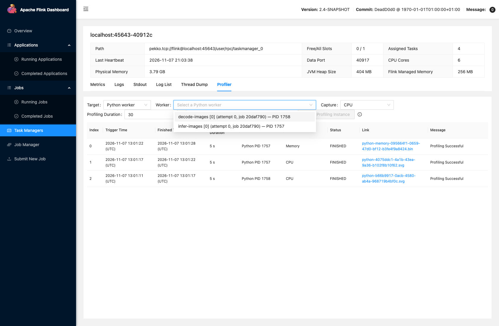
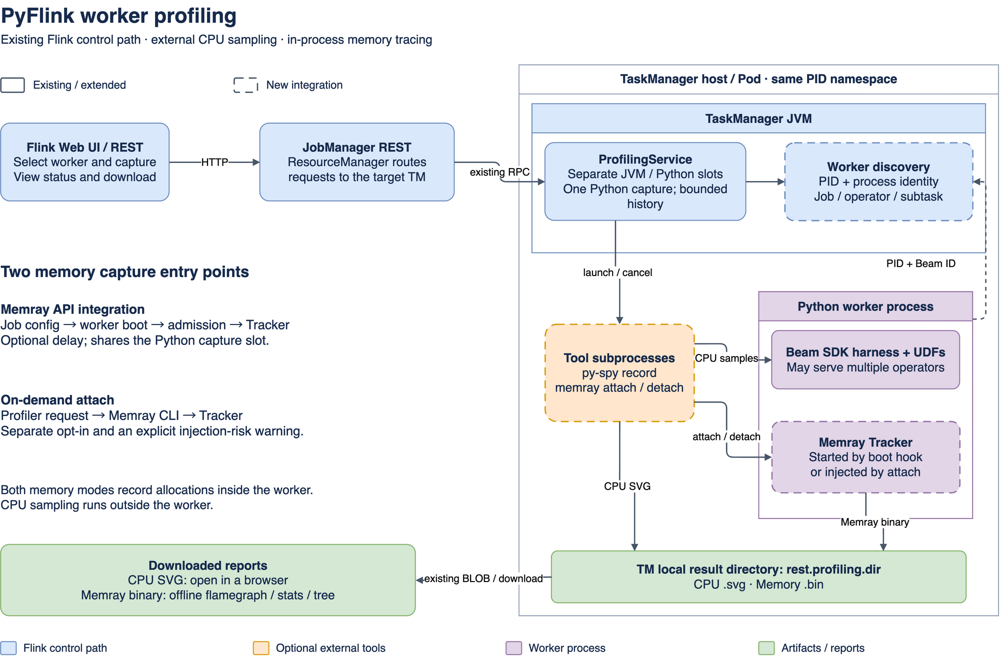
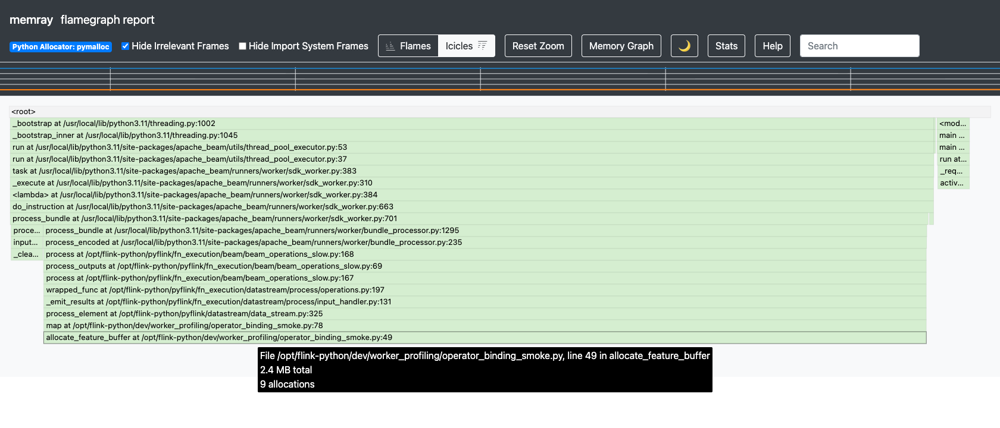
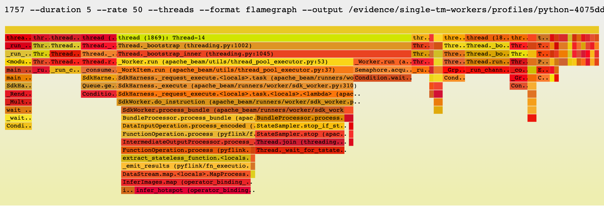

<!--
Licensed to the Apache Software Foundation (ASF) under one
or more contributor license agreements. See the NOTICE file
distributed with this work for additional information
regarding copyright ownership. The ASF licenses this file
to you under the Apache License, Version 2.0 (the
"License"); you may not use this file except in compliance
with the License. You may obtain a copy of the License at

  http://www.apache.org/licenses/LICENSE-2.0

Unless required by applicable law or agreed to in writing,
software distributed under the License is distributed on an
"AS IS" BASIS, WITHOUT WARRANTIES OR CONDITIONS OF ANY
KIND, either express or implied. See the License for the
specific language governing permissions and limitations
under the License.
-->

# FLIP-XXX: CPU and Memory Profiling for Python Workers

[中文](FLIP-draft.md) | **English**

## Motivation

As the AI ecosystem grows, PyFlink is increasingly used for real-time multimodal analysis, bringing
deep-learning frameworks and pretrained models into continuously running streaming jobs.
In PyFlink's process execution mode, user functions and the associated data processing run in
separate Python worker processes. In workloads such as real-time multimodal processing, these workers
also perform image decoding, feature transformation, and model inference. For example, a job may load
a YOLO model through PyTorch and continuously preprocess incoming images and run inference on them.
Image decoding, tensor conversion, data encoding and decoding, and model computation increase CPU
usage. Model parameters, images, tensors, and intermediate batch results increase process memory
requirements. These costs can originate in both Python code and native code within dependencies.
[PyTorch execution-time and tensor-memory profiling][pytorch-profiling]

These workloads have two typical diagnostic scenarios:

- **High CPU usage accompanied by lower throughput or higher processing latency.** Users need to
  identify the call paths that account for the time spent, such as image decoding and preprocessing,
  data conversion and encoding or decoding, user functions, or native computation within a framework,
  before they can decide what to optimize.
- **Sustained growth or high peaks in Python worker memory usage, putting the container at risk of
  OOM.** Users need to identify the call paths responsible for allocations during the relevant period
  and the allocations that remain unfreed. They need to relate this evidence to model loading,
  intermediate images and tensors, and batch buffering to understand the sources of memory usage.

CPU utilization and process memory metrics reveal resource pressure, but are insufficient to locate
its cause in code. Users also need call stacks or allocation stacks from the period in which the
problem occurs, together with results that make hotspots easy to inspect, save, and share. Allocation
records must be interpreted alongside process memory metrics; allocations that remain unfreed at the
end of a capture are not, by themselves, evidence of a memory leak.

Flink's existing diagnostic capabilities do not fully address these needs. [FLIP-375][flip-375]
provides JVM profiling initiation, status queries, and result downloads for JobManagers and
TaskManagers, but cannot directly show the call stacks of separate Python workers. PyFlink's existing
`python.profile.enabled` integration uses cProfile to collect function-call statistics during bundle
processing and writes them to logs. This integration helps analyze function execution time, but does
not provide a complete workflow for choosing capture windows on demand while workers are running,
downloading profiling files, and viewing visual reports. It also does not provide memory allocation
analysis. Tracking individual function calls can add substantial overhead to call-intensive workloads,
affecting throughput and backpressure. Online diagnostics therefore need to account for the impact of
profiling itself on the job.

The Python ecosystem already offers mature profiling tools, but using them in a distributed deployment
still involves operational work. Users typically need to access the target Pod or host, identify the
corresponding Python worker, prepare the tools and required permissions, run a capture, and retrieve
the results. Tools that collect data inside the process also need their capture lifecycle to be
managed without scattering diagnostic code across user functions. These steps lack a consistent
integration with Flink's runtime management, leaving routine CPU and memory investigations dependent
on multiple manual operations.

This proposal aims to reduce the effort required to trace Python worker resource problems to specific
code. Users should be able to obtain results that can be saved and analyzed visually, with explicit
enablement and bounded capture windows, without modifying their user functions. Profiling should
minimize disruption to normal processing and reuse Flink's existing process management and profiling
capabilities, making Python worker diagnostics a routine part of job operations.

### Goals and non-goals

This proposal covers Python workers in PyFlink process execution mode. The first release targets
Linux workers accessible to the TM on the same host and in the same PID namespace. macOS experiments
establish local feasibility, not a validated release support matrix. Administrators prepare tools
and permissions; users do not modify UDFs. Reports describe a whole worker process, which may serve
several operators.

| Capability in scope | First-release behavior |
| --- | --- |
| CPU profiling | Select a running worker in the existing TM Profiler page and capture with external py-spy sampling. |
| Memory profiling at startup | Enable a startup hook that uses Memray's public `Tracker` API in the worker, with an optional delay and one recording window per worker start. |
| On-demand memory profiling | Select a running worker and use Memray `attach/detach`, following Ray's integration pattern. This mode is separately enabled and carries an explicit injection-risk warning. |
| Results | CPU flamegraph SVG and raw Memray `.bin` recordings in the configured TM directory; reuse existing file/BLOB downloads. Memray generates HTML, stats, and tree reports offline. |

py-spy samples Python threads. Native mode extends the stacks of those threads, without guaranteeing
coverage of native threads that have no Python thread state. In the default six-thread PyTorch POC,
five active native threads were absent from the SVG. The graph therefore does not explain all of a
libtorch process's CPU consumption.

Both memory modes are formal features of this proposal. They have different activation and lifecycle
contracts. Automatic memory HTML rendering, a new viewer, continuous profiling, GPU analysis,
operator-exclusive attribution, remote storage, and a generic profiler SPI are outside the first
release. Embedded/thread mode, client loopback, remote workers, and user-created subprocesses are
also outside scope. Concurrent capture of multiple Python workers on one TM is not supported;
the Python admission limit is shared by TMs in the same JVM. Publication support requires validation of concrete tool/CPython/Linux combinations.

Related work includes [FLINK-39153][pyflink-metrics]: metrics help identify resource pressure, while
profiling connects the selected diagnostic window to code paths.

## Public Interfaces

CPU profiling and dynamic Memray attach can be started on demand from the TM Profiler page or REST.
API-integrated memory capture is triggered by job configuration; once started, it uses the same
status-query and result-download interfaces.

### Configuration

Administrators install the tools and prepare permissions. py-spy must be executable by the TM;
Memray must be installed in the worker's actual Python environment. They are independent optional
dependencies. Flink does not install tools or elevate privileges automatically.

**Shared settings**

| Configuration | Default | Meaning |
| --- | --- | --- |
| `rest.profiling.enabled` | `false`, existing | Master switch for all capture modes in this proposal. |
| `rest.profiling.dir` | `java.io.tmpdir`, existing | Local result directory; Python artifacts are stored on the hosting TM. |
| `rest.profiling.duration-max` | `300 s`, existing | Maximum capture duration for CPU, memory API integration and dynamic attach. |

**CPU settings**

| Configuration | Default | Meaning |
| --- | --- | --- |
| `rest.python-profiling.cpu.executable` | Unset, new | Absolute path to the py-spy executable. |

**Memory settings**

Dynamic attach additionally requires a configured Memray CLI and explicit enablement:

| Configuration | Default | Meaning |
| --- | --- | --- |
| `rest.python-profiling.memory.executable` | Unset, new | Absolute path to the Memray CLI. |
| `rest.python-profiling.memory.attach-enabled` | `false`, new | Permit dynamic Memray attach to running workers. |

For example, enable profiling and configure the directory and tool paths while leaving attach disabled:

```yaml
rest.profiling.enabled: true
rest.profiling.dir: /flink/log/profiling
rest.python-profiling.cpu.executable: /opt/diagnostics/bin/py-spy
rest.python-profiling.memory.executable: /opt/diagnostics/bin/memray
rest.python-profiling.memory.attach-enabled: false
```

API integration uses the following job settings. It requires the master profiling switch, but not
the Memray CLI path or attach enablement:

| Configuration | Default | Meaning |
| --- | --- | --- |
| `python.memory-profiling.startup.enabled` | `false`, new | Schedule one memory capture on each worker start. |
| `python.memory-profiling.startup.delay` | `0 s`, new | Non-negative delay from worker startup to capture. |
| `python.memory-profiling.startup.duration` | `60 s`, new | Positive capture duration, no greater than `rest.profiling.duration-max`. |
| `python.memory-profiling.startup.native` | `false`, new | Include C/C++ allocation stacks. |

For example, wait 120 seconds after each worker starts, then capture for 60 seconds:

```yaml
python.memory-profiling.startup.enabled: true
python.memory-profiling.startup.delay: 120 s
python.memory-profiling.startup.duration: 60 s
python.memory-profiling.startup.native: true
```

CPU and dynamic-attach durations are supplied with each request; API-integrated capture duration is
job configuration. `rest.profiling.duration-max` is a limit, not a default capture duration. Requests
cannot override tool paths or the result directory. Existing workers must restart to apply dependency
preparation and startup settings; the first release adds no dynamic configuration reload.
The master switch is an administrative gate for profiling, including job-triggered captures.
The TM passes its effective directory and maximum duration through existing environment preparation;
the worker validates startup values against that maximum. Client submission need not read remote
cluster configuration. Internal lock and registration paths require a shared local filesystem;
`rest.profiling.dir` controls artifacts rather than the lock path.

### Select a worker

Open the TaskManager Profiler page, select Python, and choose a worker. The page obtains the running
Python workers on that TM through:

```http
GET /taskmanagers/:tm/python-workers
```

```json
{
  "workers": [
    {
      "id": "<opaque-worker-handle>",
      "pid": 12345,
      "memoryAttachAvailable": true,
      "operators": [
        {
          "jobId": "<job-id>",
          "operatorId": "<operator-id>",
          "operatorName": "infer-images",
          "subtaskIndex": 0,
          "attemptNumber": 0
        }
      ]
    }
  ]
}
```

| Field | Purpose |
| --- | --- |
| `id` | The `workerId` used in capture requests, bound to this TM and worker process instance. |
| `pid` | Display metadata for identifying the process; requests do not accept arbitrary PIDs. |
| `operators` | Currently associated jobs, operators, subtasks and attempts; subtask indices are zero-based and operator names are the original names. |
| `memoryAttachAvailable` | The worker's Memray attach settings and dependency are prepared; this does not guarantee injection permissions or native-stack support. |

A worker can serve multiple operators; capture covers the entire process. Fused operators are listed
as runtime operators rather than individual UDFs. Associations are a query-time snapshot; an empty
list does not imply an idle process. Restart creates a new `id`. An expired selection is cleared,
never silently replaced. The page distinguishes no workers, discovery failure and unavailable capabilities.



Actual POC screenshot (2026-11-07): one TM and one slot, with Python managed memory disabled.
Two unfused operators run in PIDs 1758 and 1757. The page shows operator, subtask, attempt and PID.
The follow-up POC implements shared API admission and per-worker latest-result retention. JVM/Python
admission isolation and the TM-wide Python retention cap described below remain to be implemented.

### Start a capture

After choosing a worker, select CPU or Memory and enter a duration. Memory on the page means dynamic
attach. The duration is prefilled with 30 seconds. `includeNative` and `includeIdle` are advanced
options, disabled by default; the latter is shown only for CPU.

Both on-demand modes use the existing endpoint:

```http
POST /taskmanagers/:tm/profiler
```

CPU request:

```json
{
  "workerId": "<opaque-worker-handle>",
  "type": "CPU",
  "duration": 30,
  "includeNative": false,
  "includeIdle": false
}
```

Dynamic memory attach request:

```json
{
  "workerId": "<opaque-worker-handle>",
  "type": "MEMORY",
  "duration": 30,
  "includeNative": false
}
```

| Parameter | Required / Default | Meaning |
| --- | --- | --- |
| `workerId` | Required | A valid `id` returned by worker discovery. |
| `type` | Required | `CPU` or `MEMORY`; the latter means dynamic attach. |
| `duration` | Required | Positive integer seconds, no greater than `rest.profiling.duration-max`. |
| `includeNative` | Optional, `false` | Include native call stacks or allocation stacks. |
| `includeIdle` | Optional, `false` | Include idle/waiting threads in CPU sampling, corresponding to py-spy `--idle`; memory requests must omit this field. |

`includeIdle` can help investigate synchronous I/O, lock or queue waits when both CPU usage and
throughput are low. Samples then include waiting and cannot be read directly as CPU consumption;
they do not provide per-request I/O latency. Unsupported explicit options fail without fallback.

**Dynamic Memray attach can crash or deadlock the target worker and affect the job.** Administrators
must enable `rest.python-profiling.memory.attach-enabled`. The page shows the risk and requires
confirmation before requesting capture; REST usage documents the same risk. Memray recommends
attach for development debugging. [Attach caveats][memray-attach]

The service maintains separate **JVM and Python active-capture slots**. Python CPU, API-integrated
memory and dynamic attach share one Python slot, so workers on one TM are profiled serially.
TMs sharing a JVM share that Python limit. A Python failure does not prevent JVM profiling.

API integration requires no worker selection or REST creation request. Each worker start schedules
one window. Its delay does not reserve admission. API and REST use first-acquirer-wins admission,
with no priority, preemption, queue or retry. A busy API window is skipped and its reason appears
in the existing status query; a busy on-demand Python request returns 409. On a multi-slot TM, nearly
simultaneous worker starts may therefore record only one worker. User documentation must make that
best-effort behavior explicit rather than relying only on logs.

Configuration parsing follows existing Flink behavior. Recoverable preparation errors publish a
failed capture attempt while ordinary UDF startup continues. This does not isolate native profiler
crashes or deadlocks.

| Reason a request is not accepted | HTTP status |
| --- | --- |
| Invalid parameter type, combination, duration or query target | `400` |
| Missing TM/worker or expired handle | `404` |
| An active Python capture in the hosting Flink JVM or a known worker capture conflict | `409`, without queuing |
| Unavailable tool/worker dependency, unsupported platform or disabled attach | `503` |

Existing JVM requests retain `mode` and `duration` and need no Python fields. Python `workerId` and
JVM `mode` are mutually exclusive. Python worker capture is available only through TaskManager
Profiler; JobManager Profiler does not accept these requests.

### Query status

HTTP 200 from creation means the request was accepted, **not that capture has finished**. View status
in the page or call:

```http
GET /taskmanagers/:tm/profiler?target=python
```

CPU, dynamic attach and API-integrated capture attempts share this query, distinguished by worker
and type. No session exists during the startup delay. At the scheduled window, both started captures
and attempts skipped because of contention or preparation failure become queryable:

| Status | Meaning |
| --- | --- |
| `RUNNING` | Capture is in progress and the result is not ready. |
| `FINISHED` | Capture has ended and a complete result file is available for download. |
| `FAILED` | Capture failed or an API window could not start; `message` explains why. This does not mean the job failed and does not replace the previous successful result. |

Responses retain `status`, `triggerTime`, `finishedTime`, `duration`, `message` and `outputFile`, adding
Python `worker`, `type` and applicable capture options. `outputFile` is the result filename: SVG for
CPU or `.bin` for memory. Python responses omit JVM-specific `mode` and `profilingMode`.

`duration` describes the requested capture window. Tool initialization and file finalization affect
elapsed time, so a complete file is not guaranteed to be available immediately when the timer expires.
If a failure reports “stop unconfirmed”, Python admission remains reserved until the original
worker exits; JVM profiling remains available.
Neither memory entry point guarantees a hard stop deadline or a complete recording after OOM/SIGKILL.

Omitting `target`, or specifying `?target=jvm`, still returns existing JVM profiling information.

### Download results

After capture completes, use the page's “Download flamegraph” or “Download memory recording” action,
or use the returned `outputFile` with:

```http
GET /taskmanagers/:tm/profiler/:filename
```

| File | How to view it |
| --- | --- |
| CPU `.svg` | Download and open the flamegraph in a browser. |
| Memory `.bin` | Download and render HTML flamegraph, stats or tree offline with Memray; API integration and dynamic attach use the same format. |

Files are stored in the TM-local `rest.profiling.dir`. In-progress files cannot be downloaded, and
the first release does not automatically generate memory analysis reports.

Each worker preferentially retains its latest successful complete result per type: one CPU SVG and
one memory `.bin`. API integration and attach share the memory result. Success replaces that type's
previous file; failure preserves it.

A TM-wide cap additionally bounds ended Python sessions whose writers have stopped, using existing
`rest.profiling.history-size` (default 10). Successes, failures and skipped attempts count together,
across workers and restarted process instances. Evict the oldest by finish time and remove its owned
result file. This cap takes precedence over per-worker retention, so even an older successful result
can expire. Running and stop-unconfirmed sessions and files are protected from eviction. Worker exit
does not immediately remove a published result. Python and JVM histories count independently.

This bounds managed session/file counts during the current TM lifetime, not bytes or disk usage.
Users download files for long-term retention; TM restart does not restore session history. Deployment
storage policy governs capacity, persistence and crash leftovers, including large native recordings.

## Proposed Changes

### Architecture overview



On-demand capture follows the existing Web UI / REST → JobManager / ResourceManager → TaskManager
path. The TM resolves the worker and uses the existing `ProfilingService` to manage the session and
background execution. CPU capture runs a separate py-spy process. Memory tracking runs inside the
Python worker, activated through its startup API integration or by the external Memray CLI.
Artifacts use the TM result directory and the existing file/BLOB download path.

API-integrated memory capture starts from worker boot and must join the same session-management
flow. Solid boxes identify existing or extended integration points; dashed boxes identify additions.
[Editable draw.io source](architecture.drawio).

### Locate workers and associate operators

The first step is to resolve the operator/subtask chosen by the user to a real Python worker process.
Existing Python/Beam process management retains worker creation, exit and restart. This proposal
adds the process discovery and association information needed for profiling.

Python worker boot records the actual SDK harness PID, process-start identity and Beam worker ID
in the TM's private temporary directory. The actual PID lets external tools inspect the business
process rather than a shell wrapper. `PythonWorkerRegistry` in `flink-runtime` reads these records
and exposes a handle bound to the TM and worker process instance. The directory follows the existing
TM working-directory lifecycle.

Java operators maintain an in-memory map from JobID + Beam worker ID to operator, subtask and
attempt information. The TM and its operators obtain the same `PythonWorkerRegistry` through
existing `SharedResources`. Associations do not use files or Python managed-memory quota. Each
operator adds its entry on open and removes only its own entry on close; TM shutdown releases the map.

Python worker boot retains the existing `WORKER_ID`, with JobID passed through environment
preparation. The TM joins process registrations with the in-memory map using JobID + Beam worker ID.
Shared workers can have multiple operators, and execution attempts are registered separately.
Updates never enter the per-record or bundle hot path.

Reading the Beam worker ID stays in `flink-python`; `flink-runtime` handles plain registration data
without depending on Beam classes. The current integration uses Beam 2.75.0. Changes to worker reuse
or rotation require revalidation.

The TM checks liveness, process-start identity and TM ownership during discovery, admission, tool
launch and result publication, rejecting stale handles. External tools ultimately use a PID;
validation and attach are not atomic, so a residual PID-reuse race remains.

Process registration and API status use private UTF-8 JSON files shared by Java and Python from the
same Flink version, without a public file-format or cross-version negotiation contract:

| Record | Path and fields |
| --- | --- |
| Process | `python-workers/<registration-id>.json` under the TM private directory; `registration_id`, `job_id`, Beam `worker_id`, actual `pid`, `start_token`, attach availability and busy flags. Each process start receives a fresh registration ID. |
| API status | `profiles/<registration-id>.json` in that directory; the same process identity, `profile` session fields and `stop_confirmed`. A skipped attempt publishes `FAILED`, without a new status enum. |

Python writes a same-directory temporary file and atomically replaces the complete record. Directory
and file permissions restrict access to the runtime user. The TM validates required fields and process
identity, ignores unknown fields, and logs malformed/unreadable records without inferring process
death. Normal exit removes registration; discovery reclaims confirmed stale records. No heartbeat,
file-watcher service or worker-control protocol is added.

### Receive requests and manage capture sessions

CPU and dynamic-attach requests reach the target TM through existing REST/RPC routing. The TM
validates the target, parameters, tool configuration and enablement, then delegates to
`ProfilingService`. Retain the existing `RUNNING`, `FINISHED` and `FAILED` model and serial background
execution. Tool waits do not block TM RPC or record processing. HTTP disconnection does not cancel
an accepted capture.

`ProfilingService` maintains independent JVM and Python active slots while retaining shared session
queries, result publication and downloads. Python CPU and both memory entry points share one Python
slot, including TMs hosted by the same JVM. Busy Python requests are rejected without a queue or
parallel-worker scheduler. Python's blocking tool waits do not run on the JVM profiler stop-timer
thread; reuse the TM I/O executor where possible so Python cannot starve JVM finalization.

The service creates one Python admission lock file per JVM and passes its path through existing
environment preparation. Java `FileChannel.tryLock()` and Python POSIX `fcntl.lockf()` contend for
the same nonblocking exclusive record lock on a shared local filesystem. API capture attempts
admission after its delay, immediately before creating Tracker. The lock is held until confirmed
stop and does not gate JVM profiling. Its path is independent of `rest.profiling.dir`; the POC uses
`java.io.tmpdir`, which must be a local mount accessible to both TM and worker.

Workers atomically publish `RUNNING`, then `FINISHED` with `stop_confirmed=true` after Tracker closure
and file publication, or `FAILED` with a reason. Busy and preparation-failed attempts use the same
status handoff. The TM imports status on queries and admission, updating the same process-instance
session instead of duplicating poll results. Consumed terminal status records may be removed while
artifacts follow retention. Environment variables convey settings and paths, not return status or
Beam control commands.

SIGKILL releases the worker's kernel lock. At the next check, the TM marks its abandoned running
session failed and reclaims owned temporary files only after confirming no writer remains. A live
worker with unconfirmed Tracker stop retains Python admission even if its session is `FAILED`.

### Execute CPU capture outside the worker

The new `PythonWorkerProfiler` in the TM launches and manages a py-spy subprocess. It invokes
`record` using the configured executable and fixed arguments at 50 Hz, mapping the validated native
and idle options to `--native` and `--idle`. The initial fixed 50 Hz rate keeps the public interface
and real-tool regression baseline small. It is not a promise of fixed low overhead; throughput and
tail latency must be remeasured as required by the Test Plan. The TM chooses the output path. py-spy samples externally;
`ProfilingService` handles the resulting session state.

Measure elapsed time from tool launch. At the deadline, send SIGINT to request sampling termination
and SVG generation, then allow bounded finalization, currently 10 seconds in the POC. Initialization
consumes part of the window, so actual sampling can be shorter than requested. Keep the tool's
own duration as an additional exit condition: validated py-spy 0.4.3 counts sampling intervals, and
slow native unwinding can exceed nominal duration, so its timer alone is insufficient.

Publish success only after normal tool exit, a valid file and validated positive-sample completion
evidence. Parsing output such as `Samples: N` depends on the tested tool version; it is not a generic
protocol. Invalid or zero-sample captures fail without cProfile fallback. Killing the tool is not
successful completion.

### Execute memory capture inside the worker

Both entry points run Memray Tracker inside the Python worker, with the same allocation semantics
and `.bin` format. Reuse Python environment, archives, requirements and configuration propagation.
The TM passes the effective absolute result directory so virtual environments or working-directory
changes do not alter the path. Disabled memory profiling does not import Memray; preparing the
dependency does not start tracking.

#### API integration

Worker boot schedules one configured recording window. After the delay and shared admission, a
background thread inside the worker enters a `Tracker` context, holds it for the configured duration
and exits the context. That thread and the Beam harness run in the same Python process, without
UDF or bundle hot-path hooks. The worker continues processing afterward.

The startup integration logs effective options, tool version, PID, actual start/end times and filename.
Completion of `Tracker.__exit__` confirms tracking has closed and the file has been finalized.
Hand back the result and completion status, then release admission. Each worker restart schedules
a fresh window and file rather than appending to a predecessor. API and on-demand windows use
first-acquirer-wins admission with no preemption or retries; busy API attempts publish the skip reason. Release the file lock when tracking
never started or shutdown is confirmed; retain it until process exit if shutdown remains unconfirmed.

#### Dynamic attach

The new `PythonWorkerMemoryProfiler` in `flink-runtime` manages the external Memray CLI. Follow
Ray Reporter Agent's attach → wait → detach pattern, retaining Flink's asynchronous session management
and delivering the raw recording. The CLI activates capture in the target; allocation tracking and
recording writes happen inside the worker. [Ray agent][ray-agent] · [Ray manager][ray-manager]

After shared admission, the TM creates a unique temporary path and runs `memray attach` with fixed
arguments. At the requested window's end, invoke `memray detach`; successful detach is the normal
closure acknowledgement before file validation and publication. The attach CLI returning, a
readable file or an expired timer alone does not prove that target-side Tracker has stopped.

Validate target-side `--duration` as a fallback if the TM disappears, using the requested duration
plus a small finalization grace so normal detach precedes it. This timer is neither a hard deadline
nor proof of completion. Beam 2.75 Fn API has no Memray start/stop instruction; its bundle profiler
factory does not implement this process-level capture window. [Beam Fn API][beam-fn-api]

Only one Memray Tracker can run per worker, and Memray must not run alongside cProfile. Administrators
must not start manual Memray sessions while Flink controls the capture: the CLI cannot identify
an unrelated manual attach as a different owner's session.

### Publish results and provide downloads

The capture implementation confirms that the tool or Tracker has stopped and closed the file;
`ProfilingService` then publishes the filename and marks the session `FINISHED`. Use
`python-<uuid>.svg` for CPU, `python-memory-<uuid>.bin` for dynamic attach and
`python-memory-startup-<pid>-<uuid>.bin` for API recording. Memray initially writes `.bin.inprogress`,
publishing a complete `.bin` after closure. A valid zero-allocation memory window may finish
successfully; the CPU zero-sample failure rule does not apply.

Retain results by worker process instance and CPU/memory type. Only after successful publication
replace and remove that worker's previous result of the same type. API integration and attach
share the memory result. Failure preserves the previous successful result; cleanup touches only
owned files. Apply the TM-wide Python history cap across process instances afterward, evicting the
oldest ended session by finish time. Protect running and stop-unconfirmed writers and their files.
This bounds managed counts rather than file size; BLOB cache lifetime is independent.

Downloads reuse `FileType.PROFILER`, TM file upload and transient BLOB delivery to return complete
files from the TM result directory. In-progress files are not downloadable. Python artifacts are
attachments with `nosniff`; SVG additionally receives a restrictive CSP, and `.bin` uses
`application/octet-stream`. Local replacement does not revoke cached or downloaded copies.

Users generate Memray HTML, stats and tree reports offline. The first release delivers recordings
without running a report renderer in the worker. Existing JVM download behavior remains unchanged.

Artifact access uses existing deployment REST controls to protect files that may contain source paths.
This proposal does not establish new isolation between mutually untrusted jobs.

### Handle exit, failure and cleanup

**Worker exit.** Existing task/Beam lifecycle management retains responsibility for the business
process. When the harness returns or raises a Python exception, cancel the pending API window or
close the active Tracker once. Normal exit also removes the worker registration. Each Java operator
removes its own association on close.

**Capture failure or cancellation.** Record tool, permission, storage and worker-exit failures with
cleanup status. If CPU finalization times out, terminate/kill the sampler and fail the capture.
Memory failure/cancellation also attempts detach, bounds CLI waits and reaps tool/debugger children.
Ending the CLI does not stop target-side tracking. Do not kill the business worker as a profiler
fallback or add generic retries or sudo/setuid elevation.

**Unconfirmed memory stop.** If cleanup cannot confirm Tracker closure, mark `FAILED` and retain
the incomplete file. Do not publish success, delete/truncate a possible active writer's file, or
automatically attach again. Keep Python admission until the original worker exits; other Python
REST requests remain busy and API windows publish a skip reason. JVM profiling and its stop timer
remain independent and usable. There is no force-unlock endpoint.
Users may restore access through normal job stop/restart after considering business impact.
Memray 1.20.0 clears its “last tracker” reference before closure completes, so “no previous attach”
from detach is not a successful close acknowledgement. Ray's warning-and-render behavior after
a failed detach does not satisfy this `FINISHED` contract. Validate these paths with the supported
real tool version. [Memray lifecycle][memray-code]

**TM shutdown.** Cancel captures owned by this TM with a bounded wait, without closing a profiling
service still shared by another TM in the JVM. Late discovery must not start a capture after shutdown
begins. Existing task/Beam lifecycle management owns final worker termination. OOM/SIGKILL can leave
incomplete recordings; complete artifacts are not guaranteed.

Registration cleanup reuses existing discovery scans. Reclaim owned records only after confirming
the original process is stale. Preserve live records and unknown files; read/inspection failure is
not proof of death. Log cleanup errors while continuing to return valid workers. Abrupt TM exit
may leave registrations until its private temporary directory is reinitialized. No heartbeat or
separate cleanup service is added.

Java associations stay in memory. Close callbacks remove entries by execution attempt and operator
ID without affecting other operators or newer attempts. Queries receive a snapshot; TM shutdown
releases the registry through existing `SharedResources`.

### Tool compatibility and capability limits

**Local filesystem.** The shared lock and private registration/status directories require a local
filesystem with the required lock and atomic-publication semantics, accessible to both TM and worker.
NFS and similar network filesystems are outside the first-release coordination contract.
`rest.profiling.dir` specifies TM-local artifacts and does not select the internal lock path.

**Optional dependencies.** Administrators preinstall py-spy and Memray in the runtime images. Flink
does not bundle, install or upgrade either tool. The TM executes py-spy; the worker's actual Python
interpreter imports Memray. Dynamic attach with tested Memray 1.20.0 additionally needs the Memray CLI
and GDB or LLDB. [Memray prerequisites and caveats][memray-attach]

**Permissions.** The sampler started by the TM is normally not an ancestor of the worker. The same
user, Pod or PID namespace is therefore insufficient on its own. Under Linux Yama `ptrace_scope=1`,
the integration usually needs `CAP_SYS_PTRACE` or an explicitly allowed ptracer relationship, plus
compatible seccomp/LSM rules. Attach requires debugger access too; API integration does not require
external ptrace. Flink does not change these permissions. Deployment documentation must include a
verified TM container configuration example. [Linux Yama][linux-yama]

**CPU coverage.** `includeNative=true` extends the stacks of captured Python threads on supported
platforms; it does not guarantee visibility of native workers without Python thread state. PyTorch
intra-op pools can therefore consume CPU absent from the graph. Five active native threads were
missing in the default six-thread POC. Use the graph for Python paths and some native calls rather
than full libtorch thread accounting. [Tested py-spy implementation][pyspy-source]

**Memory interpretation.** Memray records allocations made after capture starts and their releases,
not earlier model/buffer allocations, process RSS or GPU memory. Allocations still live at the end
are not automatically leaks. Attach may crash or deadlock a worker. API integration avoids external
injection but retains profiler overhead and in-process failure risks. Both require bounded windows
and deployment storage limits.

**Tool maintenance.** User documentation lists validated platform, CPython, py-spy and Memray versions.
Flink maintains integration checks for parameters, exit semantics and artifact formats, with a
repeatable real-tool regression path covering positive samples, readable recordings and failure
cleanup. Revalidate after tool upgrades. `Samples: N` is a tested-version integration dependency;
zero exit status and a nonempty SVG alone do not prove samples were collected. No tool-version adapter
framework or generic profiler SPI is introduced.

## Compatibility, Deprecation, and Migration Plan

All new modes are opt-in. Existing JVM request/response shapes, default JVM history, file routes and
`python.profile.enabled` behavior are preserved. That option continues to mean the existing cProfile
feature; it is neither renamed nor silently replaced. Concurrent cProfile/Memray operation in one
worker is not supported.

The Python interfaces and configuration in this draft become public commitments when released.
Internal environment variables transport configuration from the TM to workers and are not user
configuration entry points. The unpublished prototype establishes no compatibility aliases; users
configure and invoke profiling through the interfaces described here.

Implementation can be reviewed in separate CPU, startup-memory, and attach-memory changes under this
one FLIP. Memory remains in scope; attach acceptance requires its warning, disabled default and real
lifecycle evidence. Existing worker processes need restart to pick up dependency preparation and
startup settings. No checkpoint/savepoint format or UDF signature changes are involved.

## Test Plan

These are acceptance requirements for the relevant implementation changes and release. Appendix A
summarizes completed prototype validation and its limits.

| Area | Required evidence |
| --- | --- |
| Protocol/compatibility | Old JVM clients and generated REST schemas; Python CPU/Memory discrimination; invalid combinations; 400/404/409/503 and download MIME/headers. |
| Identity/lifecycle | Multiple workers/TMs; PID reuse; SIGKILL registration cleanup; preserve live/unrecognized files; shared in-memory registration within one TM, isolation across TMs, and old-attempt cleanup preserving new attempts; TM shutdown, queued capture and late discovery. |
| Startup API | Disabled path without Memray; missing package; delay/normal return/exception; exactly-once closure; restart behavior; continued processing; effective result directory even with archives or disabled ambient-env inheritance. |
| Attach | Real success/permission/missing-dependency paths; injection and detach failures; fallback timer race; interrupted CLI/TM; normal worker exit with the target-side timer still pending; stop-unconfirmed state; no business-worker kill or false completion. |
| Ownership | Separate JVM/Python slots and stop scheduling; Python worker serialization; shared-JVM Python admission; API/REST first-acquirer-wins conflicts; queryable skipped attempts; unconfirmed memory stop reserves Python only; exclusive Memray control. |
| Artifacts | Real CPU SVG and closed readable Memray binary; zero allocations; incomplete files; unwritable/full output; per-worker/type replacement and failed-capture preservation; TM-wide cap across restarts including failures/skips; running and unconfirmed writers protected; cleanup after confirmed worker exit. |
| Representative load | Rerun CPU PyTorch after the stop-path fix with one thread and the default pool; compare baseline, 50 Hz CPU and Memray ordinary/native windows; report throughput, tail latency, actual duration, RSS, artifact size and visible/missing stacks. |
| User workflow | One TM with two unfused operators and Python managed memory disabled; choose by operator/subtask/attempt and verify distinct PID/hotspot pairs. Enable managed memory as a shared-worker control and verify both associations plus cleanup. Exercise the attach warning and download. |

Deployment tests cover permission failures in default containers, successful captures with explicit
permissions, and API capture without ptrace. Verify the same local lock is used on both sides,
independently of the artifact directory, with non-preemptive API/REST admission in both directions.
Repeat real-tool and representative-load checks after tool upgrades or stop-path changes.

Native Memray capture can produce large files. Verify growth, overhead and the ability to stop;
file-size monitoring can request stop but cannot impose a hard size cap on an unresponsive in-process
Tracker without affecting the worker. Operational storage limits and this limitation must be documented.
Select modest diagnostic windows and workloads for the initial support matrix.

## Rejected Alternatives

| Alternative | Reason |
| --- | --- |
| Exclude memory solely because Memray is an optional external dependency | Optional preparation is a valid deployment contract; Flink still owns integration and compatibility. |
| Add a cooperative worker command socket/RPC for this release | Startup API capture and the explicit-risk attach path cover the chosen modes without another control protocol. |
| Reinterpret Beam bundle/status/metrics messages as profiler commands | Beam has no matching operation; coupling diagnostics to those semantics would add protocol debt. |
| Separate REST service, history, artifact store, scheduler or profiler SPI | Existing Flink profiling paths already supply these responsibilities for on-demand requests. |
| Treat the attach process exit or a readable binary as completion | Recording continues in the target; stop confirmation is required. |
| Automatically render every memory report or expose every Memray option | Preserve one native binary artifact and use Memray's existing offline tools first. |
| Parallel worker captures on one TM or a new capture queue in the first release | Retain one Python slot per JVM and serial worker execution; reject requests or publish skipped API windows when busy. JVM profiling remains independent. |

### A separate Python REST path

`/taskmanagers/:tm/python-workers/:workerId/profiler` would make worker targeting explicit and could
reuse the same backend. The proposal instead extends existing TM Profiler routes because the modes
share session states and downloads. A fixed schema with optional fields and validated combinations
expresses both targets while preserving existing JVM requests and default queries. A second set of
session routes is unnecessary for the first release.

### Obtain the SDK harness PID directly in Java

Beam 2.75.0 `ProcessManager.RunningProcess` does not expose the underlying process or PID, while
`FnApiControlClient.getWorkerId()` returns a worker ID. A shell-wrapper PID need not be the final
harness PID. Copying/replacing Beam process management, reflection or another control channel expands
scope. Publish minimal process identity and API status in Python, retain operator associations in TM
memory, and revisit this internal mechanism if upstream exposes a suitable PID API.

## Appendix A: Prototype validation

These local experiments demonstrate integration feasibility, not community approval, a release support
matrix, or a production overhead guarantee. The prototype used Linux AArch64, CPython 3.11.18,
Beam 2.75.0, py-spy 0.4.3, and Memray 1.20.0.

The 2026-11-09 follow-up implements shared API admission, unified status queries, result retention,
and the `memoryAttachAvailable` name. Separate Java/Python processes verified exclusion in both
directions, a second worker skipping a busy window, a readable real Memray recording, and admission
release after completion. MiniCluster tests verify API status and files through existing REST/BLOB
routing. Targeted regressions cover failed-capture preservation, independent worker results,
unaffected JVM history, and managed propagation of the lock path. The earlier full-job experiments
below validate the original capture integration. Java associations now use a TM-owned in-memory
registry shared through `SharedResources`, with operator-close and TM-release cleanup tests. This
follow-up did not rerun the complete standalone or PyTorch overhead matrix.

The current POC still shares one JVM-wide slot among JVM and Python captures. The revised design's
JVM/Python admission and executor isolation, queryable skipped/preparation-failed attempts, TM-wide
Python history cap and confirmed-dead-worker temporary-file reclamation remain to be implemented
and validated. Existing experiments do not establish acceptance of those new requirements.

| Scenario | Observed result |
| --- | --- |
| One TM, one slot, two unfused Python operators | Disabling Python managed memory produced two workers, with operator/subtask/attempt metadata matching independently reported UDF PIDs. Individual CPU captures distinguished their hotspots; Memray recorded the selected PID's allocation stack. With managed memory enabled, one worker listed both operators and its CPU capture included both hotspots. |
| Two TMs with CPU ResNet-18 inference | The workers could be profiled independently; cross-TM handle isolation and matching downloads were verified. Same-JVM conflict tests covered the POC's original global admission. Three rounds of throughput and UDF-latency comparisons ran with a single native thread and the default six-thread pool. Five active native threads were absent from py-spy SVGs in the default-pool experiments. |
| Capture completion and lifecycle | Ordinary/native CPU, startup Tracker, and native Memray attach produced readable artifacts with matching downloads while jobs continued. Cancellation removed associations and old handles were rejected. A py-spy native-duration overrun was fixed with timed SIGINT and bounded finalization, then validated through a real REST request. |
| Protocol and regressions | Targeted configuration, discovery, REST/RPC, history, download, frontend, and Python lifecycle tests ran. In-memory operator registration was verified with a failing regression before the change and passing tests afterward, including shared workers, execution-attempt cleanup, and TM isolation. Generated REST/configuration documentation and compatibility checks passed. |

Overhead comparisons used short windows on a local VM. The complete three-round matrix predates the
CPU stop fix; only native completion was revalidated afterward, without repeating the full overhead
matrix. These results therefore establish neither a fixed production overhead nor complete native
CPU coverage.

Relevant fault and deployment combinations still need validation before merge, and additional release
platforms/versions need an expanded real-tool matrix. More complete native crash/deadlock,
permission/debugger failure, archives, and disk-capacity experiments, plus full-repository
`clean verify`, remain. Reproduction scripts, raw measurements, and screenshots are maintained
separately with implementation evidence; community discussion should include accessible attachments.

### POC result screenshots

Both report images come from the `infer-images` worker (PID 1757) in the single-TM synthetic workload
shown above. Each capture requested 5 seconds with `includeNative=false`. These are actual profiling
results, not a PyTorch/YOLO performance benchmark.



Memray 1.20.0 generated this report offline from the downloaded `.bin`; it is not an HTML viewer built
into Flink. The peak-allocation view identifies `allocate_feature_buffer`, with a tooltip showing
about 2.4 MB and nine allocations. Width represents recorded allocation bytes still live at the
capture's high-water mark, not the process's entire RSS or proof of a leak.



This screenshot renders the original SVG produced by py-spy 0.4.3 at 50 Hz. The Beam/PyFlink call chain
leads to `InferImages.map` and `infer_hotspot`. Width represents stack-sample proportions, not memory
size or exact CPU time.

See the [figure provenance](figures/README.md) for sources, original artifact checksums, and report generation.

## References

- [Existing JVM profiler: FLIP-375][flip-375].
- [Memray Tracker API][memray-api] and [attach caveats][memray-attach].
- [Ray profiling integration][ray-manager].
- [FLIP process and public-interface commitments][flip-process].

[flip-template]: https://cwiki.apache.org/confluence/spaces/FLINK/pages/65145553/FLIP+Template
[flip-process]: https://cwiki.apache.org/confluence/spaces/FLINK/pages/65145551/Flink+Improvement+Proposals
[flip-375]: https://cwiki.apache.org/confluence/spaces/FLINK/pages/272927211/FLIP-375%2BBuilt-in%2Bcross-platform%2Bpowerful%2Bjava%2Bprofiler
[memray-api]: https://bloomberg.github.io/memray/api.html
[memray-native]: https://bloomberg.github.io/memray/native_mode.html
[memray-attach]: https://github.com/bloomberg/memray/blob/v1.20.0/docs/attach.rst
[memray-code]: https://github.com/bloomberg/memray/blob/v1.20.0/src/memray/commands/attach.py
[ray-agent]: https://github.com/ray-project/ray/blob/ad7245ffb7d4c289e0d14cb2fd8c02af3c09433d/python/ray/dashboard/modules/reporter/reporter_agent.py#L641-L664
[ray-manager]: https://github.com/ray-project/ray/blob/ad7245ffb7d4c289e0d14cb2fd8c02af3c09433d/python/ray/dashboard/modules/reporter/profile_manager.py
[ray-dependencies]: https://github.com/ray-project/ray/blob/ad7245ffb7d4c289e0d14cb2fd8c02af3c09433d/python/setup.py#L258-L279
[beam-fn-api]: https://github.com/apache/beam/blob/v2.75.0/model/fn-execution/src/main/proto/org/apache/beam/model/fn_execution/v1/beam_fn_api.proto#L152-L169
[pytorch-profiling]: https://docs.pytorch.org/tutorials/recipes/recipes/profiler_recipe.html

[pyflink-metrics]: https://issues.apache.org/jira/browse/FLINK-39153
[linux-yama]: https://docs.kernel.org/admin-guide/LSM/Yama.html
[pyspy-source]: https://github.com/benfred/py-spy/blob/v0.4.3/src/python_spy.rs
