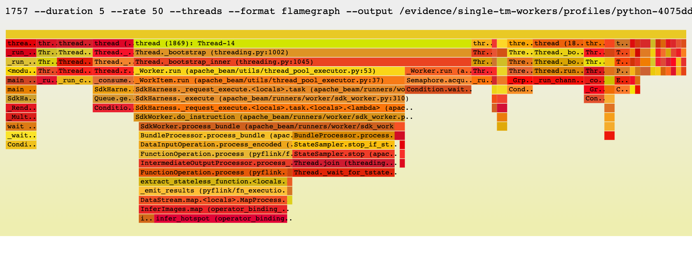
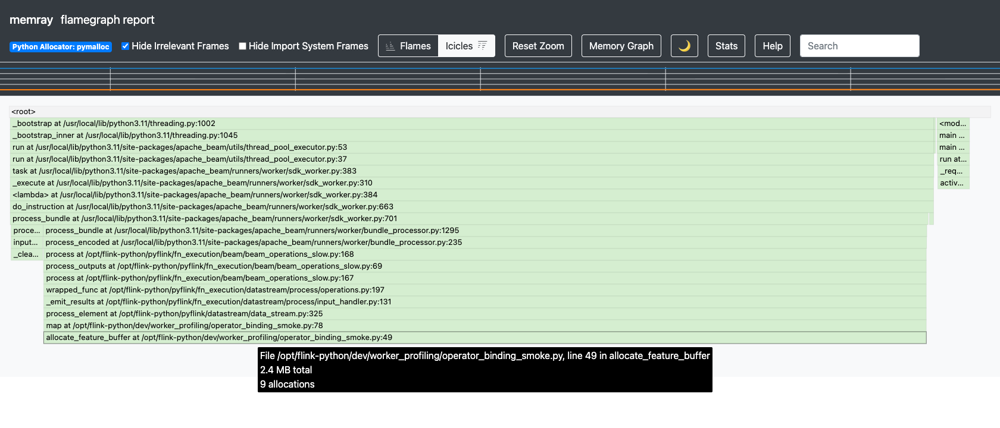
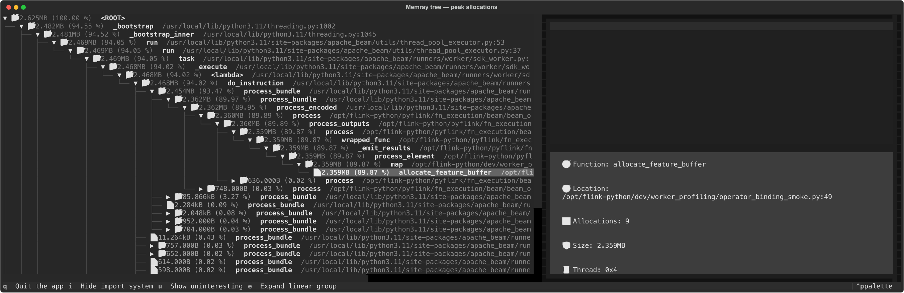
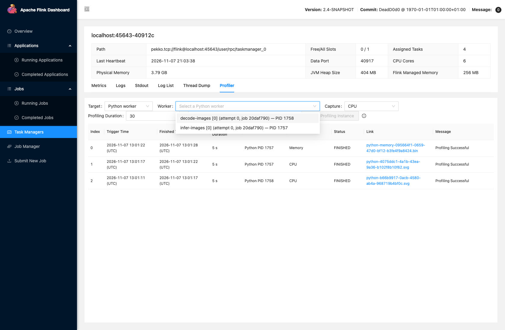
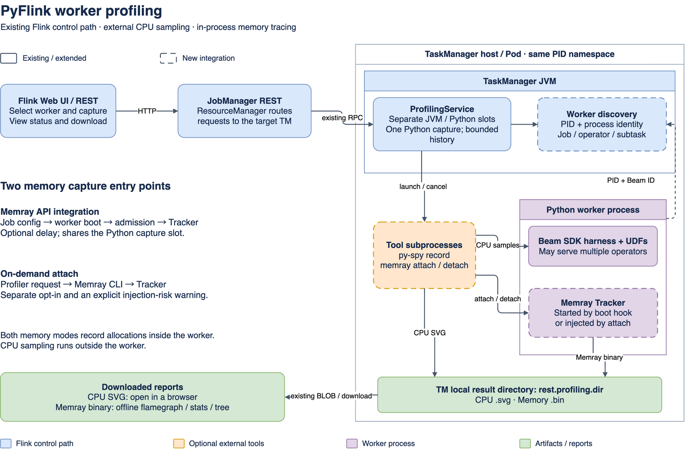

# FLIP-XXX：Python Worker CPU 与内存性能分析

## Motivation

随着 AI 生态的发展，深度学习框架和预训练模型越来越广泛地应用于图像、视频等多模态数据处理， PyFlink 也越来越多地被用于实时多模态分析，将 Python 生态中的 AI 能力接入持续运行的流处理作业。 例如，实时视频流分析作业会通过 PyTorch 加载 YOLO 模型，对持续到达的图片进行预处理、目标检测方便后续分析。在 PyFlink 的进程执行模式下，这些逻辑运行在独立的 Python worker 进程中。图片解码、张量转换、数据编解码和模型推理带来了更多 CPU 开销；模型参数、体积较大的图片与张量，以及批次中间结果则增加了内存需求。这些资源消耗既可能来自 Python 代码，也可能来自依赖库内部的原生代码， 使 Python worker 的 CPU 和内存问题成为这类作业中需要重点关注的对象。

这类作业有两个典型的诊断场景：

*   **性能：CPU 开销较高，吞吐下降或处理延迟上升。** 用户需要找出主要消耗 CPU 的调用路径，判断瓶颈位于图片解码与预处理、数据转换与编解码、用户函数，还是依赖库内部的原生计算，从而确定优化方向。

*   **稳定性：Python worker 内存持续增长或出现较高峰值，导致容器面临 OOM 风险。** 用户需要了解问题发生时段的内存由哪些调用路径分配、哪些分配仍未释放，并结合模型加载、图片与张量中间结果、批次缓冲等业务行为，分析内存占用的来源。


CPU 使用率和进程内存指标能够反映资源压力，但不足以将问题定位到具体代码。用户还需要与问题发生时段对应的调用栈或内存分配栈，以及便于查看热点、保存和共享的分析结果。Flink 已有的诊断能力尚未完整覆盖这些需求。[FLIP-375](https://cwiki.apache.org/confluence/spaces/FLINK/pages/272927211/FLIP-375%2BBuilt-in%2Bcross-platform%2Bpowerful%2Bjava%2Bprofiler) 为 JobManager 和 TaskManager提供了 JVM profiling 的触发、状态查询和结果下载，但无法直接展示独立 Python worker 的调用栈。PyFlink 现有的 `python.profile.enabled` 使用 cProfile，在 bundle 处理期间收集函数调用统计并输出到日志。这一接入方式有助于分析函数耗时，但尚未提供运行中按需选择采集窗口、下载分析文件和查看可视化结果的完整流程，也不提供内存分配分析。逐函数调用跟踪在调用密集的负载上还可能显著增加执行开销(可能慢[1.7倍](https://arxiv.org/pdf/2212.07597))，影响吞吐与背压，因此在线诊断需要考虑采集本身对作业的干扰。

Python 生态已有成熟的性能分析工具，但在分布式部署中使用它们仍有操作成本。用户通常需要进入目标 Pod 或主机，识别对应的 Python worker，准备工具及所需权限，执行采集并取回结果。对于需要在进程内采集的工具，还需要安排采集的启停，避免将诊断逻辑散落到业务函数中。这些步骤缺少与 Flink 运行管理的统一衔接，使一次常规的 CPU 或内存问题定位依赖较多手工操作。本提案希望降低从 Python worker 资源异常定位到具体代码的成本：用户无需修改业务函数，即可在明确启用和限定采集窗口的条件下，获得可保存、可视化分析的诊断结果。采集应尽量降低对正常处理的干扰，并复用 Flink 已有的进程管理和 profiling 能力，让 Python worker 的诊断成为作业运维中的常规操作。

相关的 [FLINK-39153：Add comprehensive performance metrics for PyFlink](https://issues.apache.org/jira/browse/FLINK-39153) 关注处理链路耗时与 Python 进程健康等性能指标。两者互补：metrics 帮助发现资源压力并选择诊断时段，本提案通过调用栈和内存分配栈进一步定位代码。本提案不以该 Jira 的实现为前提。

### Goals and non-goals

本提案面向以进程模式运行的 PyFlink 作业，为 Python worker 提供 CPU 和内存分析能力。用户无需修改业务函数，即可定位计算热点和内存分配来源。工具依赖和运行权限由部署方准备，具体平台及工具版本的支持范围在兼容性说明中列出。采集以 worker 进程为单位，算子和 subtask 信息用于辅助选择目标。多个算子共享同一个 worker 时，报告覆盖整个进程，不单独归因到某个算子。

下述示例来自原型的真实采集，用于展示 CPU 和内存分析能够提供的诊断结果。

**CPU 分析：进程外采样**

用户在现有 TaskManager（TM）Profiler 页面选择运行中的 Python worker，由 py-spy 在 worker 进程外进行限时采样，生成调用栈火焰图。采集产物为 SVG 文件，展示采集窗口内的调用栈及样本分布，下载后可直接在浏览器中查看。

以下截图来自单 TM、单 slot、两个未融合的 Python 算子，关闭了Python managed memory。选择 `infer-images` worker（PID 1757），请求采集 5 秒，py-spy 0.4.3 以 50 Hz 采样，`includeNative=false`、`includeIdle=false`。



图中可沿 Beam/PyFlink 调用链定位到 `InferImages.map` 和 `infer_hotspot`。

**内存分析：进程内采集**

使用[Memray](https://github.com/bloomberg/memray) 工具在 Python worker 进程内跟踪内存分配，支持两种接入方式：

*   **API 集成**：Flink 在 worker 启动入口集成 Memray 公共 `Tracker` API，按作业配置安排一次限时采集。采集可以立即开始，也可以延迟开始，用户无需修改业务函数。

*   **动态 attach**：用户在页面选择运行中的 worker，由外部命令注入 Memray 采集逻辑，实际跟踪仍在 worker 进程内进行。该能力需单独启用，并明确提示注入可能导致进程崩溃或死锁的风险。


两种方式的直接产物都是 Memray 原始 `.bin` 录制文件，保存采集窗口内跟踪到的内存分配、释放事件及相关调用栈。`.bin` 本身不是火焰图；下载后可用 Memray 离线生成 HTML 火焰图、文本统计（stats）和终端树状报告（tree）。以下分别展示原始录制文件的验证结果，以及同一份录制文件生成的三种分析报告。

**API 集成：原始录制文件**

standalone 集群实验使用 Memray 1.20.0，通过作业配置启用 Memray API 集成，得到以下采集结果：

| 验证项 | 实际结果 |
| --- | --- |
| 采集计划 | 启用 API 采集，延迟 2 秒开始，请求采集 4 秒。 |
| 目标与产物 | worker PID 为 9368，在配置目录生成 94,208 字节的完整 `.bin` 文件。 |
| 文件验证 | 通过已有下载接口取回的文件与 TM 本地文件逐字节一致；Memray FileReader 可读取并找到已知分配栈。 |
| 采集后的作业状态 | Tracker 关闭后，作业仍为 `RUNNING`。 |

这项验证使用图片缓冲区和 zlib 合成负载，验证了延迟采集、文件关闭、下载和作业继续运行。 它不构成模型初始化内存覆盖或生产开销的验证；下方 Memray 离线 HTML 报告截图来自独立的动态 attach 实验。

**动态 attach：原始录制文件与离线报告**

2026-11-07 的单 TM、双 Python 算子实验中，通过 REST 对 `infer-images` worker （PID 1757）发起 5 秒动态 attach，`includeNative=false`，会话最终为 `FINISHED`。 本次采集生成 `.bin` 录制文件，Memray 元数据中的 PID 与所选 worker 一致，下载文件与 TM 本地文件逐字节一致。下图是使用 Memray 1.20.0 将下载的 `.bin` 离线转换为 HTML 火焰图后的截图，展示其分析效果。Flink 提供下载的是原始录制文件，图中的报告由 Memray 工具单独生成。



峰值分配图能定位到 `allocate_feature_buffer`，悬浮提示约 2.4 MB、9 次分配。 宽度表示采集窗口内记录的峰值时仍存活分配的字节数，不等于整个进程的 RSS，也不代表已确认泄漏。

**stats：分配统计**

同一份 `.bin` 也可以生成文本统计。以下命令中的 `recording.bin` 表示下载后的录制文件：

```sh
python -m memray stats -n 5 recording.bin
```

本次录制的完整 stats 输出如下：

```text
📏 Total allocations:
    81920

📦 Total memory allocated:
    198.816MB

📈 Peak memory usage:
    2.625MB

📊 Histogram of allocation size:
    min: 1.000B
    --------------------------------------------
    < 3.000B   :  1152 ▇▇
    < 12.000B  :     9 ▇
    < 42.000B  : 15219 ▇▇▇▇▇▇▇▇▇▇▇▇▇▇▇▇
    < 147.000B : 17820 ▇▇▇▇▇▇▇▇▇▇▇▇▇▇▇▇▇▇▇
    < 512.000B : 24057 ▇▇▇▇▇▇▇▇▇▇▇▇▇▇▇▇▇▇▇▇▇▇▇▇▇
    < 1.782kB  : 19027 ▇▇▇▇▇▇▇▇▇▇▇▇▇▇▇▇▇▇▇▇
    < 6.208kB  :  3460 ▇▇▇▇
    < 21.618kB :   600 ▇
    < 75.281kB :     4 ▇
    <=262.144kB:   572 ▇
    --------------------------------------------
    max: 262.145kB

📂 Allocator type distribution:
     MALLOC: 42309
     REALLOC: 38409
     CALLOC: 628
     MMAP: 574

🥇 Top 5 largest allocating locations (by size):
    - allocate_feature_buffer:/opt/flink-python/dev/worker_profiling/operator_binding_smoke.py:49 -> 149.947MB
    - <stack trace unavailable> -> 10.734MB
    - process_bundle:/usr/local/lib/python3.11/site-packages/apache_beam/runners/worker/sdk_worker.py:703 -> 10.272MB
    - process_bundle:/usr/local/lib/python3.11/site-packages/apache_beam/runners/worker/sdk_worker.py:705 -> 8.471MB
    - create_monitoring_info:/usr/local/lib/python3.11/site-packages/apache_beam/metrics/monitoring_infos.py:396 -> 6.656MB

🥇 Top 5 largest allocating locations (by number of allocations):
    - consume_request_iterator:/usr/local/lib/python3.11/site-packages/grpc/_channel.py:311 -> 13738
    - create_monitoring_info:/usr/local/lib/python3.11/site-packages/apache_beam/metrics/monitoring_infos.py:396 -> 12606
    - <stack trace unavailable> -> 11735
    - process_bundle:/usr/local/lib/python3.11/site-packages/apache_beam/runners/worker/sdk_worker.py:705 -> 9168
    - wait:/usr/local/lib/python3.11/threading.py:320 -> 6587

🥇 Top 5 allocating modules (by size):
    - dev: 149.947MB total | 572 allocations
    - apache_beam: 30.805MB total | 45426 allocations
    - <root>: 10.735MB total | 11737 allocations
    - grpc: 7.321MB total | 24148 allocations
    - _memray_attach_hook: 6.024kB total | 15 allocations

🥇 Top 5 allocating modules (by number of allocations):
    - apache_beam: 30.805MB total | 45426 allocations
    - grpc: 7.321MB total | 24148 allocations
    - <root>: 10.735MB total | 11737 allocations
    - dev: 149.947MB total | 572 allocations
    - pyflink: 2.024kB total | 22 allocations
```

这表示采集窗口内累计发生 81,920 次分配，累计分配量约 198.816 MB，窗口内被跟踪分配的峰值占用约 2.625 MB。 累计分配量包含已经释放的分配，不能当作当前内存占用。完整报告按累计分配量排序的首位是 `allocate_feature_buffer`，约 149.947 MB；还包含分配大小分布、allocator 类型和按分配次数排序的位置。

**tree：峰值内存调用树**

```sh
python -m memray tree recording.bin
```

该命令打开交互式终端视图，按调用层次展示峰值时仍存活的分配。 下图从同一份 `.bin` 生成，选中了 `allocate_feature_buffer`：



所选调用路径在峰值时占用 2.359 MB，约为本次峰值的 89.87%，对应 9 次仍存活的分配。 这与 stats 中该位置累计分配的 149.947 MB 是不同口径。tree 与默认 HTML 火焰图展示相同的峰值分配视角，分别适合在终端中沿调用树查看、在浏览器中交互查看；二者都不等同于进程 RSS。完整验证范围和限制见附录 A。

**结果保存与下载**

Flink 首版提供 SVG 和 `.bin` 文件的落盘与下载能力，结果写入 `rest.profiling.dir` 指定的 TM 本地目录，复用现有文件上传与 BLOB 下载链路。Memray 的 HTML、统计和树状报告由用户下载录制文件后生成，Flink 不内置报告渲染服务。CPU 和内存采集复用现有 profiling 的状态查询、结果目录和下载流程。Python CPU 和两种内存入口共用一个 Python 采集名额，同一 TM 上的不同 worker 串行采集；JVM profiling 使用独立名额，不因 Python 采集停止失败而被阻塞。每个 worker 分别保留最新一次成功的 CPU 和内存结果，API 集成和动态 attach 共用内存结果，同时受 TM 级结果保留上限约束。

**非目标**

首版不包含以下能力：

*   同时对同一 TM 上的多个 Python worker 进行 profiling；首版不增加 Python worker 的并行采集调度。

*   持续 profiling、自动周期性采集或 GPU 性能分析。

*   将共享 worker 的资源消耗独立归因到某个算子或 UDF。

*   在 Flink 内自动渲染内存报告，或新增专用报告查看器。

*   覆盖嵌入式/线程执行模式、客户端 loopback、远程 worker 或用户自行创建的子进程。

*   新建通用 profiler SPI、独立控制服务或远程产物存储与归档系统。


## Public Interfaces

CPU 和内存动态 attach 在 TM Profiler 页面按需发起，也可以通过 REST 操作。内存 API 集成由作业配置自动触发，采集开始后使用相同的状态查询和结果下载接口。

### 配置描述

部署方预先安装工具并准备所需权限。py-spy 必须可被 TM 执行；Memray 必须安装在 worker 实际使用的Python 环境中。两者是独立的可选依赖，Flink 不自动安装工具或提升权限。

以下 `rest.*` 配置由部署方在集群侧设置，用于控制可选诊断能力、工具路径和资源边界；`python.memory-profiling.startup.*` 是作业侧的采集计划。`rest.profiling.enabled` 复用现有管理员总开关，控制本提案所有采集方式，包括不通过 REST 发起的 API 集成。该开关覆盖 REST 和 worker 启动入口两条触发路径。已有的 `python.profile.enabled` 继续指原有 cProfile，不重命名或替换。

**共用配置**

| 配置 | 默认值 | 含义 |
| --- | --- | --- |
| `rest.profiling.enabled` | `false`，已有 | 本提案所有采集方式的管理员总开关。 |
| `rest.profiling.dir` | `java.io.tmpdir`，已有 | 本地结果目录；Python 采集文件保存在所属 TM 上。 |
| `rest.profiling.duration-max` | `300 s`，已有 | 单次采集时长上限，适用于 CPU、内存 API 集成和动态 attach。 |
| `rest.profiling.history-size` | `10`，已有 | 复用其值作为每个 TM 的 Python 已结束会话总数上限，覆盖不同 worker、重启前的进程实例及 CPU/内存类型。Python 与原有 JVM 历史分别计数，互不挤占。 |

**CPU 配置**

| 配置 | 默认值 | 含义 |
| --- | --- | --- |
| `rest.python-profiling.cpu.executable` | 无，新增 | py-spy 可执行文件的绝对路径。 |

**内存配置**

动态 attach 需要额外配置 Memray CLI 并显式启用：

| 配置 | 默认值 | 含义 |
| --- | --- | --- |
| `rest.python-profiling.memory.executable` | 无，新增 | Memray CLI 的绝对路径。 |
| `rest.python-profiling.memory.attach-enabled` | `false`，新增 | 允许向运行中的 worker 动态 attach Memray。 |

例如，开启 profiling、指定结果目录和工具路径，同时保持动态 attach 关闭：

```yaml
rest.profiling.enabled: true
rest.profiling.dir: /flink/log/profiling
rest.python-profiling.cpu.executable: /opt/diagnostics/bin/py-spy
rest.python-profiling.memory.executable: /opt/diagnostics/bin/memray
rest.python-profiling.memory.attach-enabled: false
```

API 集成方式通过以下作业配置启用，不需要 Memray CLI 路径或 attach 开关，但仍受 profiling 总开关控制：

| 配置 | 默认值 | 含义 |
| --- | --- | --- |
| `python.memory-profiling.startup.enabled` | `false`，新增 | 每次 worker 启动时安排一次内存采集尝试；开始时若 Python 名额已被占用，本次跳过，不保证每个 worker 都获得录制文件。 |
| `python.memory-profiling.startup.delay` | `0 s`，新增 | worker 启动后到尝试开始采集的非负延迟。 |
| `python.memory-profiling.startup.duration` | `60 s`，新增 | 单次采集时长，必须为正数且不超过目标 TM 的 `rest.profiling.duration-max`。 |
| `python.memory-profiling.startup.native` | `false`，新增 | 是否包含 C/C++ 分配栈。 |

例如，作业可以在每次 worker 启动后等待 120 秒，再采集 60 秒：

```yaml
python.memory-profiling.startup.enabled: true
python.memory-profiling.startup.delay: 120 s
python.memory-profiling.startup.duration: 60 s
python.memory-profiling.startup.native: true
```

目标 TM 使用自身生效的总开关、结果目录和时长上限准备 worker 环境，再由 worker 在启动采集前校验作业计划。作业提交客户端不需要获取远程集群配置。总开关关闭时不安排采集；时长超限、缺少 Memray 等可处理的准备错误不会阻止 UDF 启动，并记录失败原因。

CPU 和动态 attach 的时长在每次采集请求中指定；API 集成方式的时长在作业配置中指定。`rest.profiling.duration-max` 是上限，不是默认采集时长。工具路径和结果目录不能通过采集请求覆盖。已有 worker 需要重启以应用依赖准备和启动配置，首版不提供动态配置重载。

### 选择 worker

用户进入 TaskManager 的 Profiler 页面，选择 Python，再从列表中选择目标 worker。 页面通过以下接口获取该 TM 上运行中的 Python worker：

```http
GET /taskmanagers/:tm/python-workers
```
```json
{
  "workers": [
    {
      "id": "<opaque-worker-handle>",
      "pid": 12345,
      "memoryAttachAvailable": true,
      "operators": [
        {
          "jobId": "<job-id>",
          "operatorId": "<operator-id>",
          "operatorName": "infer-images",
          "subtaskIndex": 0,
          "attemptNumber": 0
        }
      ]
    }
  ]
}
```

| 字段 | 用途 |
| --- | --- |
| `id` | 后续请求中的 `workerId`，绑定该 TM 和本次 worker 进程实例。 |
| `pid` | 帮助用户识别进程；采集请求不接受任意 PID。 |
| `operators` | 当前关联的作业、算子、subtask 和 attempt；subtask 索引从 0 开始，算子名使用原始名称。 |
| `memoryAttachAvailable` | 表示该 worker 的 Memray attach 开关和依赖已准备好，不保证注入权限或 native 栈支持。 |

一个 worker 可以关联多个算子，采集结果覆盖整个进程。融合后的算子按运行时算子展示，不拆解每个 UDF。关联信息是查询时的快照，列表暂时为空不表示进程空闲。worker 重启后获得新 `id`，旧选择失效时页面清空选择，不自动切换到另一个 worker。



真实 POC 截图（2026-11-07）：单 TM、单 slot，关闭 Python managed memory，两个未融合算子分别运行于 PID 1758 和 1757。页面显示算子、subtask、attempt 与 PID。该截图展示 worker 选择流程；后续原型对齐情况见附录 A。

### 发起采集

选定 worker 后，用户选择 CPU 或 Memory、填写时长，再发起采集。页面中的 Memory 表示动态 attach。时长默认预填 30 秒；`includeNative`、`includeIdle` 作为高级选项，默认关闭，后者仅在 CPU 模式显示。

两种按需采集共用现有入口：

```http
POST /taskmanagers/:tm/profiler
```

CPU 请求示例：

```json
{
  "workerId": "<opaque-worker-handle>",
  "type": "CPU",
  "duration": 30,
  "includeNative": false,
  "includeIdle": false
}
```

内存动态 attach 请求示例：

```json
{
  "workerId": "<opaque-worker-handle>",
  "type": "MEMORY",
  "duration": 30,
  "includeNative": false
}
```

| 参数 | 必填 / 默认值 | 含义 |
| --- | --- | --- |
| `workerId` | 必填 | worker 列表返回的有效 `id`。 |
| `type` | 必填 | `CPU` 或 `MEMORY`，后者表示动态 attach。 |
| `duration` | 必填 | 本次采集时长，单位为整数秒，必须为正数且不超过 `rest.profiling.duration-max`。 |
| `includeNative` | 可选，`false` | 包含原生代码调用栈或内存分配栈。 |
| `includeIdle` | 可选，`false` | CPU 采样包含等待、空闲线程，对应 py-spy `--idle`；内存请求不能携带该字段。 |

`includeIdle` 可辅助排查低 CPU、低吞吐时的同步 I/O、锁或队列等待。开启后，火焰图的样本占比包含等待，不能直接解释为 CPU 消耗比例，也不提供逐请求的 I/O 延迟统计。不支持的显式选项报错，不静默降级。**Memray 动态 attach 可能使目标 worker 崩溃或死锁，并影响作业。** 管理员必须先启用 `rest.python-profiling.memory.attach-enabled`，页面在发起请求前展示风险并要求确认。 REST 使用说明提供相同提示。Memray 官方建议将 attach 用于开发环境调试。[风险说明](https://github.com/bloomberg/memray/blob/v1.20.0/docs/attach.rst)

首版将 JVM profiling 与 Python profiling 的活动名额分开管理：JVM profiling 保留现有单活动采集限制；Python CPU、内存 API 和动态 attach 共用一个 Python 名额，不同 worker 不并行采集。若多个 TM 共用一个 JVM，也共享该 JVM 的 Python 名额；独立 JVM 的 TM 可各自采集。JVM 与 Python 采集互不占用对方名额，Python 内存停止未确认也不阻塞 JVM profiling。

API 集成不经过手动选择和 REST 创建。每次 worker 启动后按作业配置安排一次尝试，延迟等待不占名额；真正开始时若 Python 名额已被占用，本次跳过，不排队、不重试，也不影响作业执行。跳过或可处理的准备失败记录日志，并通过同一状态查询返回 `FAILED` 和明确的 `message`，说明本次窗口未开始；若状态文件本身无法发布，则通过 worker 日志报告。管理员总开关关闭时不创建采集会话。相关请求错误码如下：

启动窗口与按需采集采用相同规则：先成功取得 Python 名额的一方继续执行，不按触发方式设置优先级，也不抢占已有采集。按需采集正在运行时，新的 API 窗口跳过并记录失败原因；API 采集正在运行时，新的按需请求返回 `409`。多个 worker 同时开始 API 窗口时，只允许取得名额的一个录制，其余跳过，不自动补录。因此，多 slot TM 上一次启动或 failover 可能只得到部分 worker、甚至仅一个 worker 的录制文件。用户文档必须在启动采集配置和使用示例中明确说明这一行为及查询跳过原因的方法。

| 请求未受理的原因 | HTTP 状态 |
| --- | --- |
| 参数类型、组合、时长或查询 target 不合法 | `400` |
| TM 或 worker 不存在、句柄已失效 | `404` |
| Python 采集名额已占用，或存在已知的 worker 采集冲突 | `409`，不排队；JVM 采集本身不占 Python 名额 |
| 工具或 worker 依赖不可用、平台不支持、attach 未启用 | `503` |

原 JVM 请求继续使用 `mode` 和 `duration`，无需携带 Python 字段；Python 的 `workerId` 与 JVM `mode` 互斥。Python worker 采集只在 TaskManager Profiler 中提供，JobManager Profiler 不接受此类请求。

请求和响应继续使用固定 JSON schema，在现有对象中增加可选的 Python 字段，由请求校验约束合法组合。GET 通过 `target` 筛选同一响应结构中的会话列表，原有 JVM 客户端无需携带 Python 字段。

### 查看状态

创建请求返回 HTTP 200 表示已受理，**不代表采集已完成**。用户在页面查看状态或调用：

```http
GET /taskmanagers/:tm/profiler?target=python
```

CPU、动态 attach，以及 API 集成的采集尝试使用同一查询入口，按 worker 和采集类型区分。API 延迟等待期间尚未创建会话；到达计划时段后，已开始或因忙、准备失败而未能开始的尝试均可查询：

| 状态 | 含义 |
| --- | --- |
| `RUNNING` | 采集正在进行，结果尚未准备好。 |
| `FINISHED` | 采集已经结束，完整结果文件可供下载。 |
| `FAILED` | 采集失败或 API 窗口未能开始，`message` 提供原因；不表示业务作业失败，也不替换之前成功的结果。 |

响应沿用 `status`、`triggerTime`、`finishedTime`、`duration`、`message` 和 `outputFile`，并包含 Python 的 `worker`、`type` 和适用的采集选项。`outputFile` 是结果文件名，CPU 对应 SVG，内存对应 `.bin`；Python 响应不携带 JVM 专用的 `mode` 或 `profilingMode`。`duration` 是请求的采集窗口，工具初始化和文件收尾会影响实际耗时，不承诺计时结束时立即得到完整结果。若失败详情提示“停止未确认”，Python 采集名额继续保留，直到原 worker 退出；JVM profiling 仍可使用。两种内存方式均不保证硬停止期限，也不保证 OOM/SIGKILL 后存在完整产物。不带 `target` 或使用 `?target=jvm` 时，查询仍返回原有 JVM profiling 信息。

### 下载结果

采集完成后，用户点击页面中的“下载火焰图”或“下载内存录制文件”，也可以使用响应中的 `outputFile` 调用：

```http
GET /taskmanagers/:tm/profiler/:filename
```

| 文件 | 查看方式 |
| --- | --- |
| CPU `.svg` | 下载后直接在浏览器中查看火焰图。 |
| 内存 `.bin` | 下载后使用 Memray 离线生成 HTML 火焰图、stats 或 tree；API 集成和动态 attach 产物格式相同。 |

文件写入 `rest.profiling.dir` 指定的 TM 本地目录，录制中的文件不可下载，Flink 首版不自动生成内存分析报告。每个 worker、每类优先保留最新一次成功的完整结果：CPU 一份 SVG、内存一份 `.bin`，API 集成和动态 attach 共用内存结果。新采集成功后替换并清理同类旧结果，失败不替换之前的成功结果。

同时，每个 TM 内已结束且确认停止的 Python 会话总数受 `rest.profiling.history-size` 限制，成功、失败及跳过的尝试均计入，跨不同 worker 和重启前后的进程实例统一保留最新记录；超过上限按结束时间淘汰最旧记录，并清理其自有结果文件。总上限优先于每个 worker 的最新结果保留规则，因此旧的成功结果也可能因达到上限而过期。运行中或停止未确认的会话及其文件不参与淘汰。worker 退出不立即删除已发布结果，以便分析异常退出前的录制。Python 与原有 JVM 历史分别计数，原 JVM 保留规则不变。该上限约束当前 TM 生命周期内管理的会话和结果数量，不是文件字节数或目录磁盘配额。

需要长期保留的文件由用户下载保存；TM 重启不恢复会话历史。结果目录的容量、持久化和异常退出残留由部署存储策略约束，不能依靠会话数量上限为单个 native 录制文件提供硬容量保证。

## Proposed Changes

### 架构总览



按需采集沿用现有的 Web UI / REST → JobManager / ResourceManager → TaskManager 链路。TM 找到目标 worker 后，由现有 `ProfilingService` 管理采集会话，并在后台执行采集。CPU 使用独立的 py-spy 进程；内存采集器运行在 Python worker 内，由启动入口调用 API 或由外部 Memray CLI 动态 attach。两种方式生成的文件都写入 TM 结果目录，再通过现有文件/BLOB 链路下载。内存 API 集成从 worker 启动入口触发，也需要接入同一个采集会话管理流程。图中实线框表示复用或扩展的既有部分，虚线框表示本提案新增的接入。

### 定位 worker 并关联算子

首先需要把用户选择的算子/subtask 对应到一个真实的 Python worker 进程。worker 的创建、退出和重启继续由已有 Python/Beam 进程管理负责。本提案补充供 profiling 使用的进程发现和关联信息：Python worker 启动入口将实际 SDK harness PID、进程启动身份和 Beam worker ID 写入 TM 私有临时目录。记录实际 PID 是为了让外部工具访问真正执行业务的进程，避免使用 shell 包装器的 PID。

`flink-runtime` 中的 `PythonWorkerRegistry` 读取进程登记，向 REST 返回绑定 TM 和进程实例的 worker 句柄。登记目录沿用 TM working-directory 生命周期。算子关联复用 Beam 已有的 worker ID：`flink-python` 的 runner 从 stage 的 instruction request handler 获取实际 worker ID，Python boot 沿用已有的 `WORKER_ID`。JobID 通过现有环境准备链路传递，避免不同作业的 ID 冲突。

Java 算子在打开后，将作业、算子、subtask 和 attempt 信息登记到 TM 共享的内存表，关闭时删除自己的关联；不再为算子关联写文件。TM 在查询时按 JobID + Beam worker ID 将内存表与进程登记合并，一个 worker 服务多个算子时自然得到多个关联。更新只发生在算子生命周期边界，不进入逐条记录或 bundle 热路径。共享内存表复用 TM 的 `SharedResources` 生命周期。

当前 Beam 2.75.0 的接入点是 `FnApiControlClient.getWorkerId()`，只有 `flink-python` 依赖该 Beam 类；`flink-runtime` 只处理普通登记数据和关联信息，不引入 Beam 依赖。以后若改变 Beam stage/environment 的复用或轮换方式，需要重新验证关联。TM 在发现、受理采集、启动工具和发布结果前检查进程存活、启动身份及 TM 归属，拒绝已失效的句柄。两个外部工具最终仍按 PID 访问进程；检查与实际 attach 不是原子操作，保留 PID 复用竞态这一能力边界。

进程登记和 API 采集状态采用 TM 私有目录中的 UTF-8 JSON 文件，是同一 Flink 版本的 Java/Python 实现之间的内部约定，不作为用户配置文件，也不支持跨版本协商：

| 记录 | 路径与内容 |
| --- | --- |
| worker 进程登记 | `<TM-private-dir>/python-workers/<registration-id>.json`；包含 `registration_id`、`job_id`、Beam `worker_id`、实际 `pid`、`start_token`，以及内存 attach 可用和占用标记。`registration_id` 每次进程启动新建，不以复用 PID 覆盖旧实例。 |
| API 采集状态 | 同目录下 `profiles/<registration-id>.json`；包含同一进程身份、`profile` 会话字段，以及表示 Tracker 是否已确认关闭的 `stop_confirmed`。忙时跳过也发布失败记录，不创建新的状态枚举。 |

Python 先写同目录临时文件，再通过原子替换发布完整记录；私有目录和文件仅允许运行用户访问。TM 只读取完整的自有记录，校验必需字段和进程身份，未知字段可忽略；格式损坏或读取失败记录日志，不据此推断进程已经退出。正常退出删除进程登记，异常退出的回收由已有发现流程完成。无需增加心跳、文件监听服务或独立控制协议。

### 接收请求与管理采集会话

CPU 和动态 attach 请求经现有 REST/RPC 链路到达目标 TM，由 TM 校验目标、参数、工具配置和启用状态，再交给 `ProfilingService`。沿用已有 `RUNNING`、`FINISHED`、`FAILED` 状态。外部工具的等待与收尾复用后台执行能力，不阻塞 TM RPC 或数据处理线程；Python 的阻塞等待不使用 JVM profiler 的停止定时任务执行线程，优先复用 TM 现有 I/O executor。HTTP 客户端断开不会取消已经受理的采集。

`ProfilingService` 分别维护 JVM 和 Python 两个活动名额，状态查询、结果发布和下载仍复用同一服务。Python CPU 和两种内存入口共用一个 Python 名额，不同 worker 串行采集；多个 TM 共用一个 JVM 时也共享该 Python 名额。Python 名额已占用时拒绝新的 Python 按需请求，不增加队列、重试或多级并发配置。JVM 活动采集及其停止调度与 Python 独立，避免 Python 采集故障阻断 JVM 诊断。

API 集成由 worker 自行触发，在延迟结束、启动 Tracker 前取得 Python 名额。`ProfilingService` 为同一 JVM 的 Python 名额创建一个共享锁文件，并通过既有环境准备链路把路径传给 worker；Java 使用 `FileChannel.tryLock`，Python 使用 POSIX `fcntl.lockf` 的非阻塞排他锁。两者必须访问同一个本地锁文件，取得锁的一方持有到采集已确认停止。该文件锁只约束 Python 采集，不再用于 JVM profiler，也不由结果目录配置 `rest.profiling.dir` 控制。原型将锁文件放在 `java.io.tmpdir` 下，部署时需保证该目录为 TM 和 worker 共同可访问的本地挂载。

worker 在开始前发布 `RUNNING`，关闭 Tracker 并发布完整文件后写入 `FINISHED` 和 `stop_confirmed=true`，失败时发布 `FAILED` 及原因。忙时跳过或准备失败通过同一状态文件发布。TM 在现有状态查询和接纳请求时读取这些记录，按进程实例更新同一个会话，而不把轮询读到的状态重复加入历史；已接纳的终态记录可被消费，结果文件仍按保留规则管理。环境变量只传配置和路径，状态回传使用原子发布的 JSON 文件，不通过环境变量或 Beam Fn API 发送控制命令。

worker 被 SIGKILL 时内核释放其持有的文件锁；TM 下次检查时将该进程遗留的运行中会话标为失败，并回收已确认没有 writer 的自有临时文件。worker 仍存活且 Tracker 停止未确认时，不能仅凭会话已标为 `FAILED` 就释放 Python 名额。

### 执行 CPU 采集（进程外）

TM 中新增的 `PythonWorkerProfiler` 负责启动和管理 py-spy 子进程。它使用部署配置中的工具路径和固定参数调用 `record`，采样率为 50 Hz；按请求映射 `--native` 和 `--idle`，输出路径由 TM 生成。py-spy 从进程外采样目标 worker，结果处理继续交给 `ProfilingService`。

首版固定 50 Hz，用于收敛公共接口并统一真实工具验证的基准，暂不开放采样率配置。这是初始工程取舍，不代表该频率对所有负载都有固定低开销；其吞吐和尾延迟影响需要按 Test Plan 重新测量后报告。

采集从工具启动开始按实际经过时间计时。到期向 py-spy 发送 SIGINT，请求结束采样并生成 SVG， 再允许有界的收尾时间，当前 POC 为 10 秒。初始化会占用窗口，实际采样时长可能短于请求值。 保留工具自身的 duration 作为额外退出条件：已验证的 py-spy 0.4.3 按采样轮数结束，慢 native 展开可能超过名义时长，因此不能只依赖工具自身计时。只有工具正常退出、生成有效文件，并提供已验证的正样本完成信息后，才进入成功发布流程。例如 `Samples: N` 是对特定已验证版本输出的依赖，不是通用协议。无效或零样本采集标记为失败；强杀工具也不作为成功完成的证据。

### 执行内存采集（进程内）

两种内存入口最终都在 Python worker 内运行 Memray Tracker，并使用相同的分配语义和 `.bin` 格式。 依赖和配置复用既有 Python 环境、archives、requirements 及配置传递链路；TM 将生效的绝对结果目录传给 worker，避免虚拟环境或工作目录改变路径含义。内存功能关闭时不导入 Memray。

#### API 集成

worker 启动入口根据作业配置安排一个录制窗口。延迟结束并取得共享名额后，由 worker 内的后台线程进入`Tracker` context，维持配置的时长，再退出 context。采集线程与 Beam harness 在同一个Python 进程中，无需在 UDF 或 bundle 热路径添加诊断代码，录完后 worker 继续处理数据。启动入口负责记录生效参数、工具版本、PID、实际起止时间和文件名。`Tracker.__exit__` 完成意味着跟踪已关闭且文件已经收尾；随后交回结果和完成状态，再释放共享名额。每次 worker 重启重新安排一个窗口，生成新文件，不续写前一次录制。

#### 动态 attach

`flink-runtime` 中新增的 `PythonWorkerMemoryProfiler` 负责外部 Memray CLI 的启停。 它借鉴 Ray Reporter Agent 的 attach → 等待 → detach 流程，保留 Flink 的异步会话管理，直接交付原始录制文件。CLI 负责把采集逻辑接入目标进程，实际分配跟踪和文件写入发生在 worker 内。取得共享名额后，TM 为本次采集生成唯一临时路径，以固定参数执行 `memray attach`。到达请求窗口后调用 `memray detach`，以成功 detach 作为正常关闭确认，再校验文件并进入结果发布流程。

还需要在支持的 Memray 版本上验证目标侧 `--duration` 作为 TM 消失后的兜底计时，采用请求时长加少量收尾余量，让正常 detach 先于兜底触发。该计时不构成硬停止期限或成功完成证据。 Beam 2.75 Fn API 没有 Memray 启停指令，其 bundle profiler factory 也不提供这里需要的进程级采集窗口。同一 worker 只能有一个 Memray Tracker，也不能同时运行 Memray 和 cProfile。 Flink 控制内存采集期间，管理员不得另外启动手工 Memray 会话；CLI 无法辨认另一个手工 attach 是否属于不同会话。

### 发布结果与提供下载

采集实现负责确认工具或 Tracker 已停止、文件已关闭；`ProfilingService` 随后发布结果文件名并更新为 `FINISHED`。CPU 使用 `python-<uuid>.svg`，动态 attach 使用 `python-memory-<uuid>.bin`，API 录制使用 `python-memory-startup-<pid>-<uuid>.bin`。Memray 录制先写 `.bin.inprogress`，关闭后再发布完整 `.bin`。有效的零分配内存窗口可以成功完成，不沿用 CPU 的零样本失败规则。

结果先按 worker 进程实例和 CPU/内存类型保留最新成功文件，API 和 attach 共用内存结果，失败不替换上一次成功结果；再应用 TM 级 `rest.profiling.history-size` 上限，对不同 worker 和重启产生的旧实例统一淘汰。只清理本功能拥有、已确认停止写入的文件；停止未确认的占用和未完成文件不按普通历史淘汰。保留上限不改变 BLOB 自身的缓存生命周期，也不撤销用户已下载的副本。

下载复用既有 `FileType.PROFILER`、TM 文件上传和 transient BLOB 链路，将 TM 结果目录中的完整文件返回客户端。录制中的文件不提供下载。Python 产物按附件下载并设置 `nosniff`；SVG 额外设置受限 CSP，`.bin` 使用 `application/octet-stream`。本地旧结果的替换不会撤销 BLOB 缓存或用户已经下载的副本。Memray 的 HTML、stats 和 tree 由用户离线生成。Flink 首版只提供录制文件，不在 worker 中启动报告渲染进程。原有 JVM 下载行为保持不变。产物访问沿用部署已有的 REST 权限约束，保护可能包含源码路径的文件；本提案不建立互不信任作业间的新隔离机制。

### 退出、失败与清理

**Worker 退出。** Beam/task 生命周期继续负责关闭业务进程。harness 正常返回或抛出 Python 异常时，API 启动入口取消尚未开始的窗口，或让当前 Tracker 关闭一次；正常退出同时删除该 worker 的进程登记。Java 算子关闭时从 TM 内存表删除自己的关联。异常退出释放内核文件锁，TM 依据进程启动身份确认原 worker 已退出后，更新遗留会话并回收未完成的自有临时文件；已发布结果继续受 TM 级保留上限管理，不随 worker 退出立即删除。

**采集失败或取消。** 对工具、权限、存储和 worker 退出等错误记录失败状态与清理结果。CPU 采集到期收尾后仍不退出时，终止/强杀采样器并标记失败。内存采集在失败或取消时也尝试detach，对 CLI 等待设置上限并回收工具/debugger 子进程。

**内存停止未确认。** 若清理后仍无法确认 Tracker 已关闭，标记 `FAILED` 并保留未完成文件，不发布成功、不删除或截断可能仍有 writer 的文件，也不自动重新 attach。Python 名额保留到原 worker 退出；期间其他 Python 按需请求返回忙状态，API 窗口跳过并记录原因，JVM profiling 不受这一占用影响。首版没有把“强制解锁”当作停止确认的接口；用户可在评估业务影响后通过常规作业停止/重启流程让原 worker 退出。Memray 1.20.0 在关闭完成前就清空 “last tracker” 引用，因此 detach 的“没有先前 attach”错误不等于关闭成功。

**TM 关闭。** 取消本 TM 所属的采集并做有界等待，避免关闭仍被同 JVM 其他 TM 使用的 profiling service。关闭开始后不再接纳迟到查询触发的新采集；worker 的最终终止仍由已有 task/Beam 生命周期负责。OOM/SIGKILL 等异常终止可能留下未完成录制，不能保证完整产物。登记清理复用已有发现扫描。正常退出未能清理的记录，在确认原进程失效后由 TM 回收；保留存活记录和未知文件，读取或检查失败不视为进程已死，清理失败记录日志并继续返回其他有效 worker。TM 异常退出不保证立即清理，重新初始化其私有临时目录时清除残留，不新增心跳或清理服务。TM 关闭同时清空算子关联内存表，不再存在算子关联文件的发布和回收流程。

### 能力边界

**本地文件系统。** 共享锁文件及 TM 私有登记/状态目录使用支持所需文件锁和原子发布语义的本地文件系统，TM 与 worker 必须访问同一个锁文件。首版不支持将这些内部协调文件放在 NFS 等网络文件系统上。`rest.profiling.dir` 只指定采集产物目录，与锁文件路径分开；其配置仍遵循前述 TM 本地结果目录约定，不能把两者当成同一个配置约束。[Java FileLock 的平台与网络文件系统限制](https://docs.oracle.com/en/java/javase/17/docs/api/java.base/java/nio/channels/FileLock.html)

py-spy 和 Memray 由部署方预装在运行环境中，例如 TM 和 Python worker 的容器镜像。Flink 不打包、安装或升级这两个工具。py-spy 必须可被 TM 执行；Memray 必须能被 worker 实际使用的 Python 解释器导入。当前验证的 Memray 1.20.0 动态 attach 还要求 TM 能执行 Memray CLI，并在运行环境中提供 GDB 或 LLDB。[Memray attach 前提与风险](https://github.com/bloomberg/memray/blob/v1.20.0/docs/attach.rst)

**部署权限。** py-spy 是由 TM 启动的工具进程，通常不是 worker 的祖先进程，因此同一用户、同一 Pod 或同一 PID namespace 并不自动满足采集权限。Linux Yama `ptrace_scope=1` 下通常需要 `CAP_SYS_PTRACE` 或明确允许的 ptracer 关系，并需验证容器 seccomp/LSM 等安全策略。Memray 动态 attach 同样需要调试器访问权限；Memray API 集成不需要外部 ptrace 权限。Flink 不自动修改这些权限，部署文档需提供经过验证的 TM 容器配置示例。[Linux Yama 规则](https://docs.kernel.org/admin-guide/LSM/Yama.html)

**CPU 覆盖范围。** py-spy 采集 Python 线程的调用栈；`includeNative=true` 在支持的平台上补充这些线程中的原生调用栈，不保证采集没有 Python 线程状态的原生工作线程。因此，PyTorch/libtorch intra-op 线程池可能存在活跃线程未进入火焰图，不能仅凭图中样本分布解释进程的全部 CPU 消耗。POC 的默认六线程池中已有五个活跃原生线程未进入 SVG 的观察。该能力有助于定位 Python 处理路径及部分原生调用，但不是 PyTorch 原生计算的完整线程分析器。[py-spy 0.4.3 实现](https://github.com/benfred/py-spy/blob/v0.4.3/src/python_spy.rs)

**内存解释与风险。** Memray 只跟踪采集开始后发生的分配及相应释放；它不能追溯采集前已经分配的模型或缓冲区。采集窗口结束时仍存活的分配不直接等于泄漏，原始录制也不等于进程 RSS 或 GPU 显存分析。动态 attach 可能使 worker 崩溃或死锁，API 集成则避免外部代码注入，但仍存在工具开销和进程内采集故障风险；两者都需要受控窗口和部署存储约束。

**工具维护。** 发布支持以经过真实验证的平台、CPython、py-spy 和 Memray 版本组合为准，在用户文档中列出；Flink 维护工具参数、退出语义和产物格式的接入验证。保留一条可重复的真实工具回归路径，验证参数、正常退出、有效样本、Memray 文件可读性和故障收尾；升级工具后重新验证。`Samples: N` 等文本输出属于已验证版本的集成约定，退出码为 0 或 SVG 非空不能替代有效样本检查。首版不增加版本适配框架或通用 profiler SPI。

## Compatibility, Deprecation, and Migration Plan

所有新增方式均显式启用。保留 JVM 请求/响应、默认 JVM 历史、文件路由和 `python.profile.enabled` 行为；该配置继续指现有 cProfile，不重命名或静默替换。同一 worker 不支持 cProfile 与 Memray 同时采集。

## Test Plan

以下是相关实现合并及发布前的验收要求；原型已完成的验证和限制见附录 A。

| 范围 | 必需证据 |
| --- | --- |
| 协议/兼容 | 原 JVM 客户端和生成 REST schema；Python CPU/Memory 区分；非法组合；400/404/409/503；下载 MIME/headers。 |
| 身份/生命周期 | 多 worker/TM、PID 复用、SIGKILL 登记回收、保留存活/未知文件；进程和状态 JSON 的原子发布、损坏记录和重复读取；算子内存关联在正常关闭、失败和 TM 退出时清理；后台采集与迟到查询。 |
| 启动 API | 关闭时不依赖 Memray；缺包、目标 TM 的总开关和时长上限、延迟、正常/异常退出、只关闭一次、重启、继续处理；多个 worker 同时启动时忙窗口可查询为失败且原因明确；archives 或禁止继承环境变量时目录和锁路径仍正确。 |
| Attach | 真实成功、权限与缺包；注入/detach 失败；兜底计时竞态；CLI/TM 中断；兜底计时尚未结束时 worker 正常退出；停止不明；不主动杀业务 worker、不误报完成。 |
| 所有权 | JVM 与 Python 名额互不占用，Python 工具阻塞不延迟 JVM 停止；同一 Flink JVM 的 Python CPU/API/attach、不同 worker 均互斥；独立 JVM 的 TM 可各自采集；API 延迟不占名额、忙时跳过；停止未确认保留 Python 名额但 JVM profiling 仍可执行；SIGKILL 后释放；Memray 独占控制。 |
| 产物 | 真实 SVG 和已关闭可读的 Memray binary；零样本 CPU 失败、有效零分配内存窗口成功；未完成文件、不可写/空间不足；每 worker 每类最新成功结果与 TM 总上限共同生效，API/attach 共用内存结果；反复 failover、worker 退出后保留结果、跨旧实例淘汰及文件清理；Python/JVM 历史独立计数，不删除活动 writer 的文件。 |
| 代表负载 | 在 CPU 计时停止修复后的版本重测预热 CPU PyTorch 推理，覆盖单线程及默认原生线程池；重复对比不采集、50 Hz py-spy、Memray 普通/native 模式，报告吞吐、UDF 尾延迟、实际窗口、RSS 和产物大小，列明可见/遗漏栈；不以修复前矩阵代替当前版本开销证据。 |
| 操作流程 | 单 TM、两个未融合算子、关闭 Python managed memory；按算子/subtask/attempt 选择，核对独立 PID 和热点。开启 managed memory 作为共享 worker 对照，验证两个关联和关闭清理；验证 attach 提示与下载。 |

部署验证需覆盖非特权默认容器下的失败提示，以及配置所需权限后的真实采集；确认 Memray API 不依赖 attach 权限。验证 TM 与 worker 访问同一个本地锁文件，结果目录变更不改变锁路径，并覆盖启动窗口与按需请求双向冲突时的非抢占行为。真实工具回归应可重复执行，工具升级或停止路径变更后重新验证代表性负载，不能只依赖模拟 CLI 测试。

Native Memray 文件可能很大，需验证增长、开销和停止能力。 文件大小监控可以请求停止，但无法在不影响 worker 的前提下为失去响应的进程内 Tracker 强制施加硬文件上限。 部署存储约束及此限制必须写入说明；初始支持矩阵从适度窗口和小规模诊断负载取得证据。

## Rejected Alternatives

### 为 Python profiling 新增独立 REST 路径

独立的 `/taskmanagers/:tm/python-workers/:workerId/profiler` 路径能够直接表达 worker 资源，也可以复用同一后台实现。首版选择扩展现有 TM Profiler 接口，因为 JVM 和 Python 采集沿用相同的会话状态与文件下载流程，固定 schema 中的可选字段及合法组合校验已能表达两类请求，并保留原有 JVM 请求和默认查询行为。因此暂不新增一组 Python 专用会话路由。

### 直接复用 Beam 的 Memray 集成

Beam 2.75 已提供 Memray 集成，但该实现位于 Beam Python 容器的 Go 启动器中。PyFlink 的进程执行模式使用自身的启动脚本和 `beam_boot.py`，不能仅通过设置 Beam 的 profiling 选项启用这套能力。

此外，Beam 的限时采集通过向 worker 发送 SIGINT 结束录制，并在 worker 退出后以不带 profiler 的方式重新启动。这与本提案“结束采集后，由同一个 worker 继续处理数据”的目标不一致。直接复用需要调整启动入口和停止行为，并补充与 Flink 会话管理、状态查询和结果下载的集成。[Beam 实现](https://github.com/apache/beam/blob/v2.75.0/sdks/python/container/boot.go#L326-L375)

因此，本提案借鉴其在 worker 启动入口接入分析工具的思路，通过 Memray 公共 `Tracker` API 管理采集窗口，并复用 Flink 已有的 profiling 链路。

### 由 Java 直接取得 SDK harness PID

如果现有进程管理能够直接提供真实 SDK harness PID，可以减少 Python 进程登记。但当前 Beam 2.75.0 的 `ProcessManager.RunningProcess` 未公开底层进程或 PID，`FnApiControlClient.getWorkerId()` 提供的是 Beam worker ID；启动的 shell/解释器包装器 PID 也未必等于最终 harness PID。[Beam 进程管理实现](https://github.com/apache/beam/blob/v2.75.0/runners/java-fn-execution/src/main/java/org/apache/beam/runners/fnexecution/environment/ProcessManager.java)

为此复制或替换 Beam 进程管理、反射访问内部 Process，或新增进程控制通道，都会扩大本提案范围。因此首版只由 Python 发布少量进程身份和 API 采集状态，Java 算子关联保存在 TM 内存中，继续复用既有 Beam 进程生命周期。以后若上游提供可直接复用的真实 PID 接口，可以再替换这部分内部登记。

### 使用 Scalene 作为 CPU 和内存分析工具

Scalene 提供 CPU、内存及原生代码分析能力，但其接入方式与本提案选定的诊断流程存在差异。CPU 方面，Scalene 的运行期启停控制要求目标程序已经通过 Scalene 启动；其 `--pid` 选项用于控制已接入 Scalene 的进程。本提案选择 py-spy，以便对未预先接入 CPU profiler 的运行中 worker 进行进程外采样。[Scalene 使用说明](https://github.com/plasma-umass/scalene#usage)

内存方面，我们核对的 Scalene Linux/macOS 实现需要在 Python 启动时预加载原生库，并接入其采样和信号处理机制。Memray 可以在进程内通过公共 `Tracker` API 开始和结束采集，无需通过预加载环境变量启动 Python；同一工具还提供本提案选择的可选动态 attach 入口。[Scalene 预加载实现](https://github.com/plasma-umass/scalene/blob/master/scalene/scalene_preload.py) · [Memray API](https://bloomberg.github.io/memray/api.html)

本提案的内存诊断重点是保存采集窗口内被跟踪的分配、释放及相关调用栈，再离线分析峰值占用和窗口结束时仍存活的分配。Memray 的原始录制文件和离线报告流程直接对应这一目标，因此首版选择 Memray。[Memray 文档](https://bloomberg.github.io/memray/overview.html)

## Appendix A: Prototype validation

以下本地实验说明接入可行性，不代表社区批准、发布支持矩阵或生产开销保证。原型使用 Linux AArch64、 CPython 3.11.18、Beam 2.75.0、py-spy 0.4.3 和 Memray 1.20.0。

2026-11-09 的本地对齐已将 worker 发现字段统一为 `memoryAttachAvailable`，将 Java 算子关联改为 TM 共享内存表，并补齐 API 采集的文件锁准入、JSON 状态交回、查询与每 worker 每类最新成功结果保留。以上仅描述已有实现，不表示本次修订中的所有要求已经完成。

当前 POC 的 JVM、Python REST 和 API 采集仍共用原来的 JVM 级名额。真实 Java/Python 进程实验已验证双向互斥、第二个 worker 忙时跳过、Tracker 关闭后释放名额，以及真实 Memray 录制可由 FileReader 读取；Linux AArch64 容器还验证了文件锁互操作和进程退出释放。该轮机制验证不等同于完整 Flink standalone 或 PyTorch 开销实验。

本次修订新增的 JVM/Python 名额隔离、Python 阻塞任务与 JVM 停止定时器隔离、跳过/准备失败的可查询状态、TM 级跨 worker 结果总上限，以及确认进程退出后的未完成文件回收，仍需按 Test Plan 实现并验证。下述既有实验不能作为这些新要求的验收证据。

| 场景 | 已观察到的结果 |
| --- | --- |
| 单 TM、单 slot、两个未融合 Python 算子 | 关闭 Python managed memory 时产生两个 worker，算子/subtask/attempt 与 UDF 自报 PID 一致；分别采集的 CPU 图区分各自热点，Memray 记录了指定 PID 的分配栈。开启 managed memory 后，一个 worker 列出两个算子，CPU 图包含双方热点。 |
| 两个 TM、CPU ResNet-18 推理 | 两个 worker 可独立采集，跨 TM 句柄隔离及下载结果得到验证；同 JVM 冲突测试验证的是原型当时的全局互斥规则。单线程与默认六线程原生池各完成三轮吞吐和 UDF 延迟对照，默认池中五个活跃原生线程未进入 py-spy SVG。 |
| 采集完成与生命周期 | 普通/native CPU、启动 Tracker 和 native Memray attach 均产生可读产物，下载与本地文件一致，作业继续运行；取消后关联记录清理，旧句柄被拒绝。py-spy native 时长超限问题经计时 SIGINT 和有界收尾修复后，通过真实 REST 请求验证。 |
| 协议与回归 | 已运行配置、worker 发现、REST/RPC、历史、下载、前端和 Python 生命周期的定向测试；后续已覆盖 API 状态交回、重复读取、不同 worker 结果隔离、文件锁互斥及算子内存关联清理。已有生成 REST/config 文档和兼容性检查通过；不代表新增名额隔离和总量上限已经实现或通过检查。 |

开销对照来自本地 VM 的短窗口实验，且完整三轮矩阵采自 CPU 停止修复之前；修复后仅重新验证了 native 采集完成，没有重复完整开销矩阵。因此不据此承诺固定的生产开销或完整原生 CPU 覆盖。

合并前仍需完成本次修订的实现对齐、修复后代表性开销重测，以及相关故障与部署组合验证。发布支持更多版本或平台前需要扩展真实工具矩阵。更完整的 native 崩溃/死锁、权限/debugger 故障、archives 和磁盘容量实验，以及全仓库 `clean verify` 仍待完成。复现脚本、原始数据和截图单独保存在实现验证记录中，社区讨论时应提供可访问的证据附件。

CPU 火焰图、Memray API 集成验证结果，以及动态 attach 的 HTML、stats 和 tree 报告见 Goals and non-goals 中对应的 CPU 和内存分析部分。

## References

*   [现有 JVM profiler：FLIP-375](https://cwiki.apache.org/confluence/spaces/FLINK/pages/272927211/FLIP-375%2BBuilt-in%2Bcross-platform%2Bpowerful%2Bjava%2Bprofiler)。

*   Memray Tracker API。

*   [Ray 的 profiling 接入实现](https://github.com/ray-project/ray/blob/ad7245ffb7d4c289e0d14cb2fd8c02af3c09433d/python/ray/dashboard/modules/reporter/profile_manager.py)。

*   [PyFlink 性能指标相关工作：FLINK-39153](https://issues.apache.org/jira/browse/FLINK-39153)。

*   [Memray 1.20.0 attach 前提与风险](https://github.com/bloomberg/memray/blob/v1.20.0/docs/attach.rst)。

*   [Linux Yama ptrace 权限](https://docs.kernel.org/admin-guide/LSM/Yama.html)。

*   [py-spy 0.4.3 调用栈采集实现](https://github.com/benfred/py-spy/blob/v0.4.3/src/python_spy.rs)。

*   [FLIP 流程和公共接口约定](https://cwiki.apache.org/confluence/spaces/FLINK/pages/65145551/Flink+Improvement+Proposals)。

*   [https://github.com/plasma-umass/scalene](https://github.com/plasma-umass/scalene)
